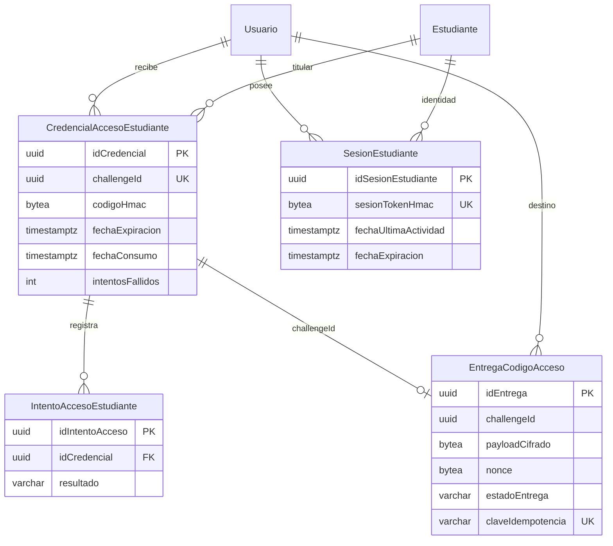

# DD-02 — Diseño de persistencia

**Estado:** Diseño autorizado — sin DDL en app  
**Complementa:** [`DD02-DICCIONARIO-DATOS.md`](DD02-DICCIONARIO-DATOS.md), [`DD02-PROPUESTA-MIGRACION.md`](DD02-PROPUESTA-MIGRACION.md)

---

## 1. Objetivos

1. Persistir credenciales OTP verificables por HMAC (sin OTP en claro).
2. Registrar intentos para límite de fuerza bruta (5).
3. Persistir sesiones estudiantiles independientes del Bearer docente.
4. Encolar entregas OTP cifradas (AES-256-GCM) en Outbox propia de M7, en la **misma TX** que la credencial.
5. No tocar V001–V009 ni tablas académicas de convocatoria (`EnvioCorreo` / `Aviso` de M4–M7 actuales).

---

## 2. Diagrama entidad-relación

---

## 3. Ciclo de vida

### 3.1 Solicitud OTP

1. Normalizar correo; resolver Usuario/Estudiante **internamente** (respuesta pública genérica).
2. Invalidar credenciales previas no consumidas del mismo estudiante (revocación).
3. Generar OTP 8 dígitos; calcular HMAC; fijar expiración = now + 5 min; `fechaProximoReenvioPermitido` = now + 60 s.
4. En la misma TX PostgreSQL: INSERT credencial + INSERT Outbox cifrada (`Propagation.MANDATORY` en adaptador M7).
5. Commit → worker OTP post-commit.

### 3.2 Validación OTP

1. Localizar por `challengeId`; verificar no revocada, no consumida, no expirada, intentos &lt; 5.
2. Comparar HMAC; en fallo incrementar intentos + INSERT IntentoAcceso.
3. En éxito: UPDATE consumo atómico (`fechaConsumo IS NULL` en WHERE); crear SesionEstudiante; cookie con token aleatorio (solo hash/HMAC en BD).

### 3.3 Sesión

- Expiración absoluta 8 h; inactividad 30 min vía `fechaUltimaActividad`.
- Revocación en logout o seguridad.
- `StudentAccessPort` solo lee contexto de sesión estudiantil (nunca Bearer docente).

### 3.4 Outbox / SMTP

- Fallo pre-commit al insertar Outbox → rollback credencial (DD02-12a).
- Fallo SMTP post-commit → reintentos; no autenticar sin OTP válido (DD02-12b).

---

## 4. Separación de secretos

| Dato | Almacenamiento |
| --- | --- |
| OTP en claro | Solo memoria al generar / al descifrar para SMTP |
| Verificación OTP | `codigoHmac` + `keyVersion` |
| Payload correo | `payloadCifrado` + `nonce` + `keyVersion` (claves fuera de PG) |
| Cookie sesión | Token opaco al cliente; `sesionTokenHmac` en BD |

---

## 5. Compatibilidad con esquema vigente

- FKs solo a `"Usuario"` y `"Estudiante"` (V001).
- Sin ALTER de tablas V001–V009.
- Sin dependencia de `EnvioCorreo` / `Aviso`.
- Nombre de script Flyway: **pendiente** de [`DD02-INVENTARIO-FLYWAY.md`](DD02-INVENTARIO-FLYWAY.md) (aprobación 2).

---

## 6. Criterio de aceptación del diseño

Dirección valida este documento + diccionario. No implica versión Flyway ni ejecución.
