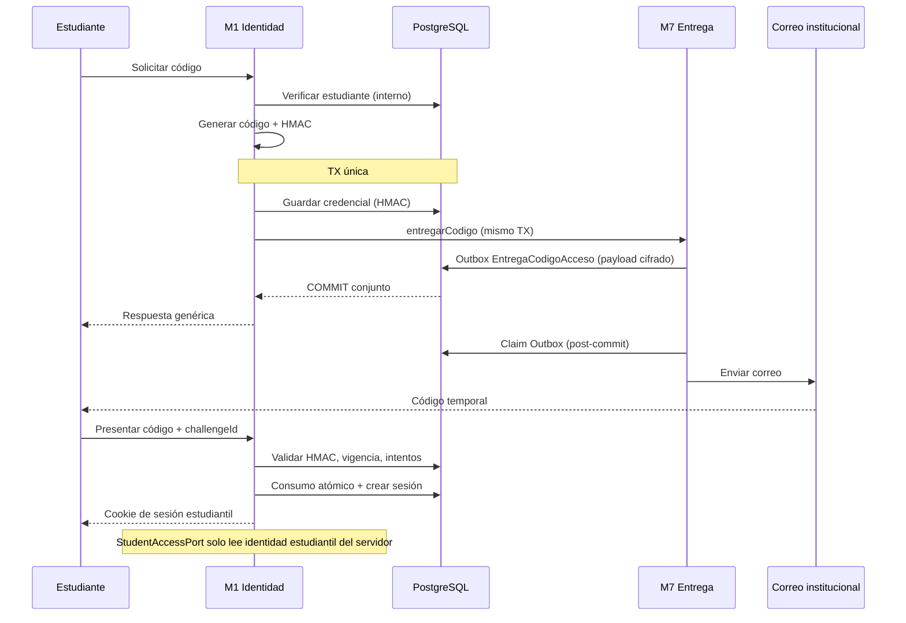

# PRISALY — PLAN DE IMPLEMENTACIÓN DD-02

## Autenticación estudiantil mediante código temporal institucional

**Responsables:** Integrante 1 — M1 / M7  
**Estado:** Ratificación técnica recibida — implementación autorizada bajo condiciones — **sin activación productiva**  
**Versión:** 1.1  
**HEAD de referencia de auditoría:** `d85bf85` (`feature/m1-m7-estabilizacion`)  
**Auditoría / preparación:** [`DD02-V010-AUDITORIA.md`](DD02-V010-AUDITORIA.md) · [`DD02-INVENTARIO-FLYWAY.md`](DD02-INVENTARIO-FLYWAY.md) · diccionario / diseño / SQL / pruebas Postgres (ver contrato M1–M5 § Related)  
**Supersede:** borrador v1.0 (dictamen técnico + cinco precisiones de ratificación)

---

## 0. Cambios respecto a v1.0

| Punto | Precisión v1.1 |
| --- | --- |
| DD02-12 | Fallo al **encolar** (rollback) ≠ fallo **SMTP** posterior (reintento / recuperación) |
| Idempotencia M1–M7 | Una TX PostgreSQL + **Outbox** cifrada; SMTP fuera de la TX |
| Seguridad | Bearer de **personal** y cookie de **estudiante** separados; sin cruce |
| V010 (M4 propuesta) | Intacta; excluida de `db/migration` por empaque M4 (no por location exclusiva en app) |
| Parámetros OTP | **Ratificados** (8 dígitos, 5 min, 5 intentos, reenvío 60 s, sesión 8 h, inactividad 30 min) |
| DDL DD-02 | Propuesta **V011** en app — **no creada** hasta conciliar bases compartidas |

**Estado operativo vigente:**

- `DenyingStudentAccessService` activo.
- `StudentAccessPort` / `AuthenticatedStudent` sin cambio de firma.
- V001–V009 intactas; V010 M4 intacta fuera de ejecución automática; **V011 no creada**.
- SMTP productivo y auth estudiantil **no** habilitados.

---

## 1. Objetivo

Preparar la autenticación de estudiantes de PRISALY mediante un código temporal de un solo uso enviado al correo institucional registrado.

| Módulo | Responsabilidad |
| --- | --- |
| **M1** | Generar, validar, consumir y revocar credenciales; establecer sesión estudiantil; publicar `StudentAccessPort` |
| **M7** | Entregar el correo OTP vía adaptador del puerto definido por M1 (Outbox cifrada + worker) |
| **M4** | Autorización académica (convocatorias consultables); **sin** autenticación paralela |
| **M5** | Participaciones e intentos; identidad solo vía `StudentAccessPort` |

El adaptador productivo `DenyingStudentAccessService` permanece activo hasta cumplir ratificación **y** autorización de activación.

---

## 2. Alcance

### Incluido (documentación / diseño)

- Flujo OTP, contratos Java, puerto M1→M7, Outbox, persistencia candidata, sesiones, seguridad de cola, feature flag, pruebas DD02-01…14 (con 12a/12b), archivos previstos.

### Excluido

- Activación en producción; sustitución del denying; cambios en M2–M6; modificación de V001–V009; **creación efectiva de V010**; uso de la cola de convocatorias (`NotificacionPort` / `EnvioCorreo` académico) para OTP; cambios Angular; SMTP productivo.

---

## 3. Flujo funcional propuesto



### 3.1 Solicitud

El estudiante proporciona su correo institucional. M1:

1. Normaliza el correo.
2. Resuelve (internamente) estudiante registrado y habilitado.
3. Aplica límites de solicitud / reenvío (parámetros recomendados).
4. Genera código criptográficamente seguro de **ocho dígitos** (recomendado).
5. Calcula **HMAC-SHA-256**; persiste solo la representación protegida.
6. En la **misma transacción**, invoca `StudentAccessDeliveryPort.entregarCodigo` para registrar la Outbox cifrada en M7.
7. Si el registro Outbox falla → **rollback** de credencial y solicitud (DD02-12a).
8. Respuesta pública **genérica** (sin enumerar existencia de correo):

> Si el correo corresponde a un estudiante habilitado, recibirás un código de acceso.

### 3.2 Atomicidad M1–M7 (Outbox)

| Fase | Comportamiento |
| --- | --- |
| Dentro de TX | M1 guarda HMAC; M7 escribe fila Outbox con payload cifrado, nonce, versión de clave, idempotencia |
| Commit | Ambas escrituras confirman juntas |
| Post-commit | Worker M7 reclama Outbox y habla con SMTP **fuera** de la TX de solicitud |
| Fallo al encolar (pre-commit) | Rollback: no queda credencial usable (DD02-12a) |
| Fallo SMTP (post-commit) | Reintento transitorio / fallo permanente registrado; **nunca** autenticar sin código válido presentado (DD02-12b) |

**Requisito de atomicidad (precisión v1.1):** la Outbox solo es atómica si M1 y el adaptador M7 de `StudentAccessDeliveryPort` comparten el **mismo recurso transaccional PostgreSQL** (mismo `DataSource` / `PlatformTransactionManager` del monolito) y la escritura Outbox participa en la **misma** transacción abierta por la solicitud M1 (`Propagation.MANDATORY` o equivalente sobre la conexión actual). Anotar ambos métodos con `@Transactional` en aislamiento **no** basta si usan gestores distintos, conexiones no enlistadas o commits locales separados.

No se usa transacción distribuida entre procesos: una sola TX PostgreSQL + procesamiento SMTP asíncrono post-commit.

Un fallo SMTP posterior al encolado **no** invalida automáticamente la credencial sin política de recuperación ratificada; el estudiante solo entra presentando un OTP válido no consumido y vigente.

### 3.3 Validación

Entrada: identificador opaco de solicitud (`challengeId`) + código. M1 verifica existencia, HMAC, vigencia, no consumo, no revocación, límite de intentos. El consumo es **atómico** (un solo éxito bajo concurrencia — DD02-13).

Los comandos **no** aceptan `studentId` como prueba de identidad.

### 3.4 Sesión

Tras validación correcta: consumir credencial; generar id de sesión aleatorio; persistir representación protegida (hash/HMAC); establecer identidad estudiantil en el contexto de seguridad **distinto** del personal; emitir **cookie** segura (HttpOnly, Secure, SameSite según política app).

La sesión es **general del estudiante**, no atada a una sola convocatoria. M4 decide qué convocatorias puede consultar esa identidad.

---

## 4. Separación de identidades (obligatoria)

| Canal | Uso | No puede |
| --- | --- | --- |
| Bearer provisional de **personal** | `IdentityAccessPort` / operaciones docentes | Convertirse en `AuthenticatedStudent` |
| Cookie de **sesión estudiantil** | `StudentAccessPort.requireCurrentStudent()` | Autorizar operaciones docentes |

`requireCurrentStudent()` **solo** reconoce identidad estudiantil válida en el servidor.  
Un Bearer docente ante el puerto estudiantil → denegación.  
Una cookie estudiantil ante APIs de personal/M4 docentes → denegación / no autenticado docente.

Reglas centrales de HTTP siguen en `app` (`HttpApiConfig`); no abrir `permitAll` estudiantil improvisado.

---

## 5. Contratos Java propuestos

### 5.1 Conservados (sin cambio de firma)

```java
public interface StudentAccessPort {
    AuthenticatedStudent requireCurrentStudent();
}

public record AuthenticatedStudent(UUID userId, UUID studentId) {}
```

### 5.2 Aplicación M1 (nuevo, feature-flagged)

```java
public interface StudentAccessApplicationPort {
    SolicitarCodigoResult solicitarCodigo(SolicitarCodigoCommand command);
    ValidarCodigoResult validarCodigo(ValidarCodigoCommand command);
    void cerrarSesion();
}
```

### 5.3 Puerto M1 → M7 (nuevo; **no** es `NotificacionPort`)

**Dirección de dependencia:** M1 **define** el contrato; M7 **implementa** el adaptador. M1 no depende del módulo M7.

```java
public interface StudentAccessDeliveryPort {
    void entregarCodigo(CodigoAccesoDeliveryCommand command);
}
```

Contenido conceptual del comando: `challengeId`, correo destinatario, código temporal (solo en memoria hacia el adaptador que cifra), expiración, clave de idempotencia.

Ubicación prevista del contrato: paquete/API de M1 (o artefacto de contrato mínimo) visible para M7 **sin** dependencia circular y **sin** mezclarlo con el contrato de convocatorias de M4.

M7 no valida credenciales ni crea sesiones.

---

## 6. Diseño de persistencia (candidato V011)

**Gate local aprobado** ([`DD02-V010-AUDITORIA.md`](DD02-V010-AUDITORIA.md)). **V011 no se crea** hasta conciliar bases compartidas y autorización explícita. No reutilizar el número V010 (artefacto M4).

Script previsto (cuando se autorice): `app/src/main/resources/db/migration/V011__dd02_acceso_estudiante.sql`

| Tabla candidata | Rol |
| --- | --- |
| `CredencialAccesoEstudiante` | HMAC, vigencia, consumo, revocación, intentos, `keyVersion` |
| `IntentoAccesoEstudiante` | Auditoría de intentos (sin códigos en claro) |
| `SesionEstudiante` | Sesión protegida (hash/HMAC del id), actividad, expiración, revocación |
| `EntregaCodigoAcceso` | Outbox M7: payload cifrado, nonce, key version, estado, reintentos, idempotencia |

Nunca almacenar OTP ni id de sesión en claro.  
No reutilizar `EnvioCorreo.contenido` de convocatorias para OTP.

---

## 7. Seguridad de entrega M7

| Tema | Propuesta (pendiente de ratificación) |
| --- | --- |
| Cifrado | AES-256-GCM; claves fuera de PostgreSQL |
| TTL | Alineado a vigencia OTP; no enviar vencidos |
| Logs | ids, fechas, resultados; **nunca** OTP, HMAC, cookies, claves |
| Retención | Inaccesible/borrar tras entrega o vencimiento según política aprobada |
| SMTP | Aceptación del proveedor ≠ entrega en buzón |

Worker OTP: opt-in / deshabilitado por defecto, análogo al worker de convocatorias; no activar SMTP productivo en esta fase.

---

## 8. Feature flag

```properties
prisaly.m1.student-access.enabled=false
```

| `false` (default) | `true` (solo tras activación autorizada) |
| --- | --- |
| Denying activo | Adaptador real de `StudentAccessPort` |
| `/validar` → 501 (o ruta de solicitud/validación aún no expuesta) | Flujos OTP + sesión |
| Sin sesiones estudiantiles | Sesión cookie |

No habilitable desde Angular. Si se activa sin secretos, V010 aplicada o adaptador M7 → **fallo seguro**.

---

## 9. Archivos previstos (implementación futura)

### M1

Puerto existente; comandos/servicios OTP; dominio credencial/sesión; persistencia; filtro/cookie estudiantil; presentación acceso; flag; pruebas.

### M7

Adaptador `StudentAccessDeliveryPort`; Outbox `EntregaCodigoAcceso`; worker OTP; cifrado/TTL/limpieza; pruebas GreenMail + Testcontainers.

### App

Security: separación Bearer vs cookie; registro de filtros; ITs de monolito. **Sin** modificar M2–M6 para anticipar.

---

## 10. Riesgos y mitigaciones

| Riesgo | Mitigación |
| --- | --- |
| Fuerza bruta | Límites por credencial, correo e IP (retención mínima) |
| Enumeración | Respuesta genérica |
| Reutilización OTP | Consumo atómico |
| Filtración OTP | HMAC + Outbox cifrada; logs limpios |
| Robo de sesión | Cookie HttpOnly/Secure; hash en BD; expiración/inactividad |
| Reenvíos | Intervalo y límites recomendados |
| SMTP caído | Reintentos; no auth sin OTP válido |
| Doble validación | Update atómico |
| Fallo Outbox pre-commit | Rollback credencial (DD02-12a) |
| Cruce docente/estudiante | Contextos y puertos separados |

---

## 11. Pruebas obligatorias DD02

| ID | Escenario | Resultado esperado |
| --- | --- | --- |
| DD02-01 | Correo institucional registrado | Solicitud aceptada (mensaje genérico) + Outbox/credencial en TX |
| DD02-02 | Correo no registrado | Misma respuesta genérica; sin filtración |
| DD02-03 | Código correcto | Autenticación + cookie estudiantil |
| DD02-04 | Código incorrecto | Rechazo; incremento de intentos |
| DD02-05 | Código vencido | Rechazo |
| DD02-06 | Código reutilizado | Rechazo |
| DD02-07 | Nuevo código solicitado | Anterior invalidado según política |
| DD02-08 | Superar intentos | Bloqueo controlado |
| DD02-09 | Manipular identidad desde Angular | Rechazo |
| DD02-10 | Sesión vencida / inactividad | Reautenticación |
| DD02-11 | Sesión revocada | Rechazo |
| **DD02-12a** | M7 no puede **registrar** entrega (Outbox) | Rollback: sin credencial usable |
| **DD02-12b** | Outbox OK, **SMTP** falla | Pendiente/reintento; no auth sin OTP válido |
| DD02-13 | Dos validaciones concurrentes | Un solo consumo exitoso |
| DD02-14 | Consultar datos ajenos (M5/titularidad) | Rechazo |

Herramientas: JUnit, Mockito, PostgreSQL Testcontainers, GreenMail.

Plan de pruebas deny-safe / S1–S10 y enlace de navegación: partir del contrato canónico [`M1-M5-STUDENT-IDENTITY-CONTRACT.md`](M1-M5-STUDENT-IDENTITY-CONTRACT.md) (este archivo es el destino del enlace canónico del Plan DD-02).

---

## 12. Autorizaciones solicitadas a Dirección

Respuesta formal pedida sobre:

1. **Parámetros** de autenticación (recomendados abajo).
2. **Migración V011** (autorizar DDL tras bases compartidas; hoy **sin archivo**).
3. **Cifrado AES-256-GCM** de la Outbox OTP — ratificado.
4. **Persistencia y administración de sesiones** estudiantiles — ratificado.

| Parámetro | Valor | Estado |
| --- | --- | --- |
| Longitud OTP | 8 dígitos | Ratificado |
| Vigencia OTP | 5 minutos | Ratificado |
| Sesión máxima | 8 horas | Ratificado |
| Inactividad | 30 minutos | Ratificado |
| Intentos máximos | 5 | Ratificado |
| Reenvío mínimo | 60 segundos | Ratificado |
| Revocación | Consumo, reenvío, vencimiento o revocación explícita | Ratificado |
| Persistencia DDL | **V011** (no V010) | Gate local OK; bases compartidas **pendientes**; archivo **no creado** |
| Cifrado cola OTP | AES-256-GCM | Ratificado |
| Sesiones | Persistencia compartida segura + cookie | Ratificado |

---

## 13. Orden de trabajo

| Fase | Estado | Contenido |
| --- | --- | --- |
| Preparación | Cerrada (plan v1.1 + auditoría V010) | Contratos, Outbox, seguridad, gate local |
| Ratificación técnica | **Recibida** | Parámetros, AES-GCM, sesiones |
| Conciliación Flyway compartida | **Pendiente** | Bloquea V011 |
| Implementación | Bloqueada hasta OK V011 | M1/M7/app detrás de flag |
| Activación | Bloqueada | Acta final; regresión; flag |

Orden técnico posterior a OK de bases compartidas + V011:

1. Autorizar y crear `V011__dd02_acceso_estudiante.sql`.  
2. M1 persistencia + políticas OTP/sesión.  
3. M7 Outbox + adaptador + worker OTP (off by default).  
4. Sesión estudiantil + separación Security.  
5. Adaptador real de `StudentAccessPort` detrás del flag (denying default).  
6. Ejecutar DD02-01…14 (12a/12b).  
7. Validar consumo M4/M5.  
8. Autorización de activación.  
9. Habilitar flag solo en entorno autorizado.

---

## 14. Criterio de cierre técnico vs producción

**Cierre técnico:** Solicitud → generación → Outbox (TX) → entrega SMTP post-commit → validación → consumo único → sesión cookie → `StudentAccessPort` desde servidor → autorización M4 → titularidad M5.

**Producción:** requiere acta explícita de activación. Aceptación técnica ≠ autorización de producción.

---

## 15. Mensaje a Dirección Técnica (plantilla)

> Aceptamos el dictamen DD-02 como línea base (correo institucional, OTP 8 dígitos de un solo uso, HMAC-SHA-256, roles M1/M4/M5/M7).  
> Entregamos el **Plan de Implementación v1.1** con Outbox transaccional, separación Bearer/cookie y escenarios DD02-12a/12b.  
> Solicitamos respuesta formal sobre: (1) parámetros, (2) V010, (3) AES-256-GCM, (4) sesiones persistidas.  
> **Aprobar el mecanismo no aprueba DDL, ni altera V001–V009, ni activa acceso estudiantil.**  
> Mientras tanto: denying activo; sin V010; SMTP productivo off.

---

**Estado final v1.1 (post-gate local):** RATIFICACIÓN TÉCNICA RECIBIDA. DENYING ACTIVO. V010 M4 INTACTA (fuera de `db/migration` en JAR). V011 NO CREADA. BASES COMPARTIDAS PENDIENTES. PRODUCCIÓN NO HABILITADA.
