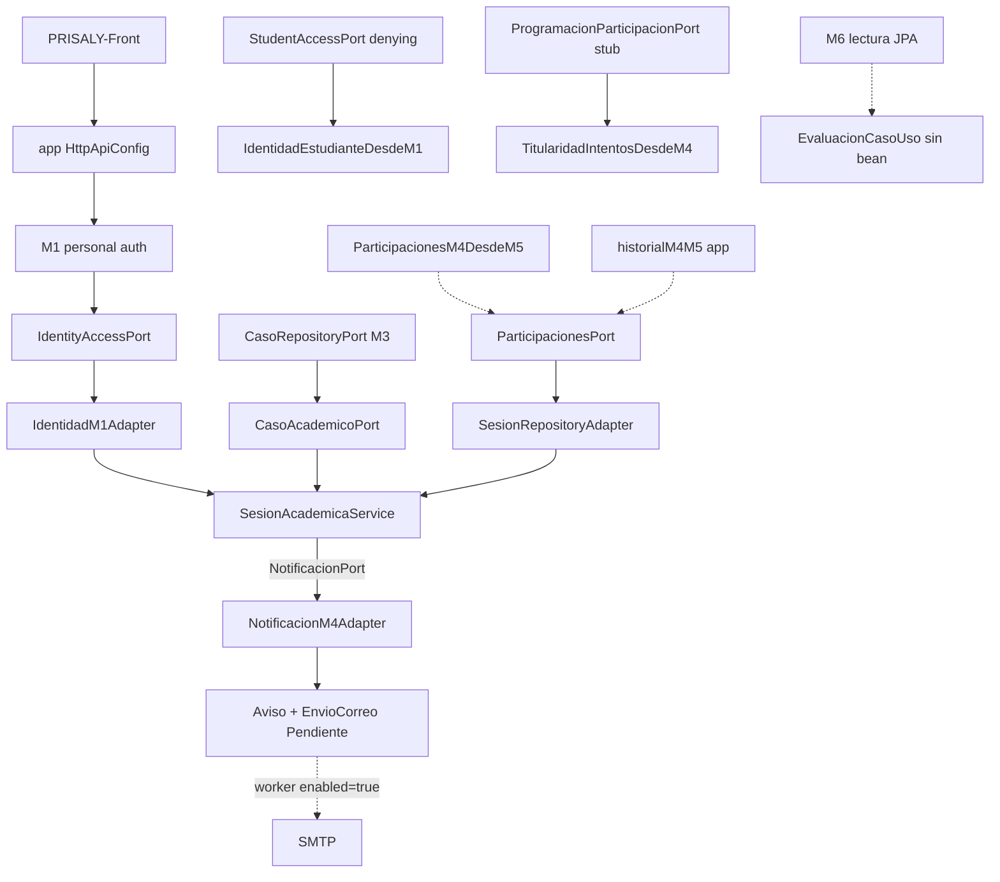

# PRISALY — Mapa técnico de integración M1–M7

**Referencia de código:** `ee77a57` (*Merge pull request #17 from Cris-count/feature/m5-cierre-tecnico*)  
**Rama de trabajo al elaborar el mapa:** `feature/m7-notificaciones`  
**Alcance:** documentación. Sin cambios de Java, Security, beans, SMTP, worker, Flyway, commits ni push.

## 0. Alcance y leyenda de evidencia

Este documento describe el código **disponible en `ee77a57`**, no necesariamente el tip de cada rama independiente (`feature/m1-identidad-acceso`, `feature/m3-gestion-casos`, etc.). Avances posteriores a ese commit, si existen solo en ramas no fusionadas, deben citarse aparte.

| Etiqueta | Significado |
| --- | --- |
| **Implementado y verificado con pruebas** | Código + suite ejecutada / reportada en el módulo (IT o unitaria citada) |
| **Implementado e inspeccionado estáticamente** | Código y anotaciones leídos en HEAD; sin prueba de contexto completo en esta entrega |
| **Disponible bajo configuración** | Existe, pero solo se registra o opera con propiedad explícita |
| **Provisional** | Esqueleto, deny-safe o stub fail-closed |
| **Bloqueado** | Decisión académica / DD pendiente |
| **No verificado** | No se ejecutó arranque ni IT de contexto completo en esta entrega |

**No se afirma** que el monolito arranca sin error en `PrisalyApplication` completo: no se ejecutó esa prueba aquí.

---

## 1. Diagrama del flujo académico (estado en `ee77a57`)

Leyenda de flechas discontinuas: cableado condicional, dual o no activado por defecto.

---

## 2. Matriz de contratos por módulo

### M1 — Identidad / acceso

| Contrato / pieza | Proveedor | Consumidor | Estado | Evidencia |
| --- | --- | --- | --- | --- |
| Auth personal + token provisional | `PersonnelAuthenticationService`, filter en app | Front / Security | Implementado e inspeccionado; pruebas M1/Bruno documentadas en docs M1 | `m1/.../PersonnelAuthenticationService.java`; `app/.../HttpApiConfig.java` |
| `IdentityAccessPort` | `IdentityAccessService` `@Service` | M4 `IdentidadM1Adapter` | Integrado (inspección) | `m1/.../IdentityAccessPort.java` |
| `StudentAccessPort` | `DenyingStudentAccessService` `@Service` | M5 `IdentidadEstudianteDesdeM1`; M4 `ProgramacionAutenticadaM1Adapter` | Provisional deny-safe; auth real **bloqueada DD-02** | `m1/.../DenyingStudentAccessService.java`; `docs/M1-M5-STUDENT-IDENTITY-CONTRACT.md` |
| `POST /v1/acceso-estudiante/validar` | Controller M1 | — | **Bloqueado** (501 hasta DD-02) | Contrato M1–M5 |

Contrato disponible ≠ flujo HTTP estudiantil operativo.

### M2 — Gestión académica provisional

| Pieza | Estado | Evidencia |
| --- | --- | --- |
| Módulo | Provisional / esqueleto | Solo `m2/.../package-info.java`; pom sin dependencias de negocio |

### M3 — Gestión de casos

| Contrato / pieza | Proveedor | Consumidor | Estado | Evidencia |
| --- | --- | --- | --- | --- |
| `CasoRepositoryPort` | `CasoPersistenceAdapter` `@Repository` | M4 `CasoAcademicoM3Adapter` (si no hay JDBC BD-005.2) | Implementado e inspeccionado | `m3/.../CasoPersistenceAdapter.java` |
| `CasoUpdatePort` | `CasoCommandUpdateAdapter` `@Repository` | Comandos M3 | Implementado e inspeccionado | `m3/.../CasoCommandUpdateAdapter.java` |
| `CasoJpaAggregateReader` | `@Component` | Lecturas agregadas M3 | Implementado e inspeccionado | `m3/.../CasoJpaAggregateReader.java` |
| `CaseAuthorizationPort` | **Sin implementación en `src/main`** | `CasoApplicationService` (constructor) | Provisional: servicio no es bean Spring | `CaseAuthorizationPort.java`; `CasoApplicationService` es `final` sin estereotipo |
| Controllers / API HTTP M3 | — | — | **No verificado** en esta entrega como superficie pública completa | Inspección limitada a ports/adapters citados |

### M4 — Programación y convocatorias

| Contrato / pieza | Proveedor | Consumidor | Estado | Evidencia |
| --- | --- | --- | --- | --- |
| `SesionAcademicaService` | Clase en m4 (scan) | Controllers M4 | Implementado; ITs M4 reportadas en el módulo | `m4/.../SesionAcademicaService.java` |
| `IdentidadPort` | `IdentidadM1Adapter` o fallback denegador | Servicio M4 | Integrado con M1 si hay `IdentityAccessPort` | `M4ProviderAutoConfiguration` |
| `CasoAcademicoPort` | JDBC BD-005.2 preferido; sino M3; sino stub 503 | Servicio M4 | Implementado + fallback | Misma auto-config |
| `NotificacionPort` | **M7** `NotificacionM4Adapter` (`notificacionM7`) | `convocarEstudiante` | Integrado (IT app `NotificacionPortWiringIT` en árbol) | `m7/.../M7Configuration.java`; `app/.../NotificacionPortWiringIT.java` |
| `ParticipacionesPort` | Ver §3 | `SesionRepositoryAdapter` | Riesgo de ambigüedad | §3 |
| `ProgramacionParticipacionPort` | Stub por defecto; JDBC si `enabled=true` | M5 titularidad; `ProgramacionAutenticadaPort` | Disponible bajo configuración | §4 |
| `ProgramacionAutenticadaPort` | `ProgramacionAutenticadaM1Adapter` | Consultas autenticadas | Implementado; depende de `StudentAccessPort` deny | `M4ProgramacionConsultaAutoConfiguration` |

### M5 — Participación e intentos

| Contrato / pieza | Proveedor | Consumidor | Estado | Evidencia |
| --- | --- | --- | --- | --- |
| Persistencia participación / intentos / respuestas | Adapters JPA M5 | Fachada M5 | Implementado y con ITs en m5 (inspección de clases de test) | `m5/src/test/...` |
| `HistorialParticipacionPort` | Adapter JDBC/JPA M5 | Proveedores de `ParticipacionesPort` | Implementado e inspeccionado | `m5/.../api/HistorialParticipacionPort.java` |
| `ParticipacionesM4DesdeM5` | `@Component` | M4 vía `ParticipacionesPort` | Implementado; IT de módulo aislado | `ParticipacionesM4DesdeM5.java`; `ParticipacionesM4DesdeM5IT` |
| Identidad estudiante | `IdentidadEstudianteDesdeM1` | Operaciones M5 | **No operativo para estudiante HTTP**: DD-02 | Docs M1–M5; tests con denying |
| Titularidad vía M4 | `TitularidadIntentosDesdeM4` | Acceso protegido M5 | Bloqueado en runtime sin consulta BD-005.2 (503) | Docs M5; stub M4 |

### M6 — Evaluación / calificaciones

| Contrato / pieza | Proveedor | Consumidor | Estado | Evidencia |
| --- | --- | --- | --- | --- |
| `ConsultaCalificacionPort` | `CalificacionReadAdapter` `@Component` | Lectura | Implementado e inspeccionado; IT JPA en m6 | `CalificacionReadAdapter.java` |
| `ConsultaRetroalimentacionPort` | `RetroalimentacionGeneralReadAdapter` `@Component` | Lectura | Implementado e inspeccionado | Adapter M6 |
| `EvaluacionCasoUso` / `AutorizacionEvaluacionPort` / `EstrategiaEvaluacion` | Sin `@Configuration`/`@Bean` productivo | Proxy unit-testeado | Provisional; **DD-03** pendiente (sin estrategia por defecto) | `EstrategiaEvaluacion.java`; `m6/docs/M6-INC-03.md` |
| `EvaluacionProtectionProxy` | Clase `final`, no bean | Tests unitarios | Implementado como biblioteca; no cableado app | `EvaluacionProtectionProxy.java` |

### M7 — Comunicaciones

| Contrato / pieza | Proveedor | Consumidor | Estado | Evidencia |
| --- | --- | --- | --- | --- |
| `NotificacionPort` productivo | `M7Configuration.notificacionM7` | M4 convocatoria | Integrado | `M7Configuration.java`; Fase 2 docs |
| Encolado `Aviso` / `EnvioCorreo` Pendiente | Adapters JPA M7 | `NotificarConvocatoriaService` | Implementado y verificado en ITs M7 (Fase 1–2) | `M7ConvocatoriaPostgreSqlIT` |
| Worker SMTP (reclamo, lease, reintentos) | `M7WorkerConfiguration` | Scheduler | **Implementado**; **no activado** por defecto | §5; `docs/M7-FASE3.md` |

---

## 3. Riesgo prioritario: `ParticipacionesPort` (inspección estática)

### 3.1 Definiciones productivas en HEAD

| Id | Origen | Tipo Spring | Nombre bean típico | `@Primary` / condición |
| --- | --- | --- | --- | --- |
| A | `m5/.../ParticipacionesM4DesdeM5.java` | `@Component` | `participacionesM4DesdeM5` | Ninguna |
| B | `app/.../HistorialM4M5Configuration.java` | `@Bean` | `historialM4M5` | Ninguna |
| C | `m4/.../M4ProviderAutoConfiguration` | `@Bean` + `@ConditionalOnMissingBean(ParticipacionesPort.class)` | `participacionesNoDisponibles` | Solo si no hay A ni B |

Ambas A y B implementan la misma semántica aproximada: listar convocatorias de la sesión vía M4 y preguntar a `HistorialParticipacionPort.existeParticipacion`.

### 3.2 Consumidor

- `SesionRepositoryAdapter` exige `ParticipacionesPort` por **tipo** en el constructor (`@Autowired` overload con `JdbcTemplate`).
- Inyección por tipo con **dos** beans sin `@Primary`/`@Qualifier` suele producir `NoUniqueBeanDefinitionException` **si ambos llegan a registrarse**.

### 3.3 Qué demuestran las pruebas existentes (y qué no)

| Prueba | Contexto | Afirmación | Límite |
| --- | --- | --- | --- |
| `ParticipacionesM4DesdeM5IT` | SpringBootTest **acotado** (importa A, no B) | Exactamente 1 bean, instancia A | No incluye `HistorialM4M5Configuration` |
| `HistorialM4M5IT` | `@SpringBootTest` app + Testcontainers | Espera `size()==1` y bean `historialM4M5` | **No re-ejecutada en esta entrega**; su resultado en `ee77a57` queda **no verificado aquí** |
| Arranque `PrisalyApplication` sin perfil de test | — | — | **No verificado** |

### 3.4 Dictamen del mapa

**Estado:** *riesgo de ambigüedad detectado por inspección estática* — **no** declarado como fallo confirmado de ejecución.

**Acción recomendada a Dirección (sin ejecutar ahora):** IT de contexto completo que haga `getBeansOfType(ParticipacionesPort.class)` sobre `PrisalyApplication` y documente cardinalidad y bean inyectado en `SesionRepositoryAdapter`. Solo después, conciliación app/M5 (un proveedor).

**Responsables tentativos:** Arquitectura + integrantes M4/M5 (cableado); app es ensamblador.

---

## 4. Consulta BD-005.2 (`prisaly.m4.consulta-bd0052`)

Fuente: `M4ProgramacionConsultaAutoConfiguration`.

| Propiedad | Bean | Comportamiento |
| --- | --- | --- |
| Ausente o `false` (`matchIfMissing = true`) | Stub `consultaNoDisponible` | `ConsultaProgramacionNoDisponibleException` en `consultarSesion` / `consultarConvocatoria` |
| `true` | `ProgramacionParticipacionJdbcAdapter` | Lectura JDBC de programación; exige `JdbcTemplate` al arrancar |

`application.yml` de app **no** define la propiedad → stub activo por inspección.

### Seguridad / contrato académico

Activar `enabled=true` **no** es solo “quitar un 503”. Implica:

1. Exponer consultas de sesión/convocatoria vs estudiante vía JDBC del esquema BD-005.2.
2. Alimentar `ProgramacionAutenticadaPort` (ya cableado), que combina esa consulta con `StudentAccessPort` (hoy denying / DD-02).
3. Desbloquear caminos de **titularidad** M5 que hoy fallan cerrados.

**Requisito previo a cualquier activación:** validar con Dirección Académica / M4–M5 qué comprobaciones de titularidad, convocatoria y sesión quedan habilitadas y si coinciden con contratos aprobados. Esta entrega **no** activa la propiedad.

---

## 5. Worker M7: implementado vs activado

| Aspecto | Estado | Evidencia |
| --- | --- | --- |
| Código (reclamo SKIP LOCKED, lease, política 5 intentos, SMTP JavaMail, GreenMail IT) | **Implementado** | `M7WorkerConfiguration`, `ReclamoEnvioJpaAdapter`, `ProcesarEnviosPendientesService`, `M7EnvioWorkerPostgreSqlIT`; docs `M7-FASE3.md` |
| Registro Spring | Solo si `prisaly.m7.worker.enabled=true` | `@ConditionalOnProperty` |
| Default en app | **Desactivado** | Sin propiedad en `application.yml`; `M7WorkerDisabledTest` |
| Encolado sin worker | Operativo vía Fase 2 | `NotificacionPort` → Pendiente; no envía correo |

Worker implementado ≠ correos saliendo.

---

## 6. Dependencias académicas y decisiones pendientes

| Id | Tema | Impacto | Estado |
| --- | --- | --- | --- |
| **DD-02** | Autenticación / identidad estudiantil real | M5 HTTP estudiante; `ProgramacionAutenticadaPort` útil | Bloqueado; denying publicado |
| **DD-03** | Fórmula, ponderaciones, escala, redondeo evaluación | `EstrategiaEvaluacion` sin default | Bloqueado / documentado en M6-INC |
| V010 / CHECK `estadoEnvio` | Catálogo SQL EnvioCorreo | Integridad en BD | No autorizado |
| Opt-in BD-005.2 | Titularidad M5 | Operación vs seguridad | Off; requiere evaluación §4 |
| Opt-in worker M7 | Entrega SMTP | Ops / secretos | Off |
| M2 alcance | Módulo vacío | — | Sin definición de negocio |

---

## 7. Orden de integración propuesto (para asignación, no ejecución)

Alineado con la prioridad provisional de Dirección Técnica:

### Prioridad 1 — Cableado M4–M5 (`ParticipacionesPort`)

1. IT de contexto completo: cardinalidad de beans + qué instancia recibe `SesionRepositoryAdapter`.
2. Conciliar un único proveedor (app **o** M5), sin tocar V001–V009.
3. Responsables: M5 + app/Arquitectura; M4 solo si cambia el contrato del puerto.

### Prioridad 2 — Titularidad / consulta BD-005.2

1. Revisar semántica de `ProgramacionParticipacionJdbcAdapter` y tests M4 de configuración.
2. Decidir entorno (local vs prod) y checklist de seguridad §4.
3. No confundir con DD-02: aunque se active la consulta, el estudiante sigue deny-safe.
4. Responsables: M4 (propiedad/adapter) + M5 (titularidad) + Dirección Académica.

### Prioridad 3 — Operación M7

1. Confirmar en humo: convocatoria → aviso + `EnvioCorreo` Pendiente (ya cableado).
2. Runbook de activación controlada del worker (props + SMTP) **sin** habilitar aún en prod.
3. Responsable: integrante M1/M7.

### Posterior

- DD-02 → desbloquear M5 estudiante y utilidades de `ProgramacionAutenticadaPort`.
- DD-03 → M6 evaluación productiva.
- M2 cuando exista alcance.

---

## 8. Matriz de pruebas sugeridas (quién)

| Prueba | Objetivo | Dueño tentativo |
| --- | --- | --- |
| `PrisalyApplication` + `getBeansOfType(ParticipacionesPort)` | Cerrar riesgo §3 | app / M5 |
| Regresión `HistorialM4M5IT` vs `ParticipacionesM4DesdeM5IT` tras conciliación | Un solo proveedor | M5 / app |
| Titularidad M5 con stub vs JDBC (propiedad documentada, no prod) | Comportamiento 503 vs datos | M4 / M5 |
| `NotificacionPortWiringIT` + convocatoria IT M7 | M4↔M7 estable | M7 |
| `M7WorkerDisabledTest` + IT GreenMail solo en perfil docker-it M7 | Implementado ≠ activado | M7 |
| Auth personal Bruno/M1 | M1 operativo | M1 |
| Negativo estudiante (DD-02) | Deny-safe | M1 / M5 |

---

## 9. Responsables sugeridos por tema

| Tema | Dueño principal | Depende de |
| --- | --- | --- |
| Auth personal, `IdentityAccessPort`, denying estudiante | M1 | DD-02 (Dirección) |
| Casos / autorizaciones de edición | M3 | CaseAuthorizationPort |
| Programación, convocatoria, consulta BD-005.2 | M4 | Decisión activación |
| Historial, participación, titularidad, `ParticipacionesPort` M5 | M5 | M4 consulta; DD-02 |
| Ensamblado `HistorialM4M5Configuration`, Security HTTP | app / Arquitectura | M4–M5 |
| Avisos, cola, worker SMTP | M7 | Ops SMTP; no V010 |
| Evaluación / calificaciones escritura | M6 | DD-03; M3/M5 contexto |
| M2 | Por asignar | Alcance de negocio |

---

## 10. Resumen de riesgos priorizados

1. **P1 — Ambigüedad estática `ParticipacionesPort` (A+B)** sin fallo de arranque confirmado en esta entrega.
2. **P2 — Consulta BD-005.2 off:** titularidad M5 fail-closed; activar exige revisión de seguridad/contratos, no solo quitar 503.
3. **P3 — DD-02:** M5/M4 “listos” a nivel de código no implican estudiante operativo.
4. **P3 — Worker M7 off:** cola sí; entrega SMTP no.
5. **M6 evaluación** y **M2** no cierran el ciclo académico extremo a extremo.
6. **HEAD `ee77a57`:** incluye merges #15 M7, #16 M3, #17 M5 sobre develop; ramas locales independientes pueden ir por delante o detrás — contrastar antes de asignar parches.

---

## 11. Lo no verificado en esta entrega

- Arranque real de `PrisalyApplication` con cardinalidad de `ParticipacionesPort`.
- Resultado actual de `HistorialM4M5IT` / `-pl app -Pdocker-it verify` sobre `ee77a57`.
- Superficie HTTP completa de M3/M5/M6 (solo ports/adapters citados).
- Contenido de ramas no fusionadas posteriores a `ee77a57`.
