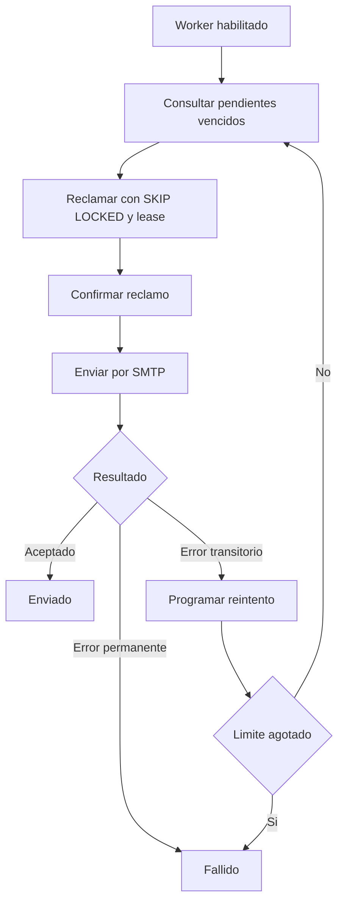

# PRISALY — M7 FASE 3

# Preparación técnica: entrega y gestión de correos

**Rama:** `feature/m7-notificaciones`  
**Última integración reportada:** `cba8f54`  
**Estado:** Decisiones D1–D11 ratificadas; implementación en [`M7-FASE3.md`](M7-FASE3.md).  
**Alcance original:** diseño y documentación (este archivo se conserva como registro de la preparación).

---

## 1. Objetivo

Preparar la tercera fase de M7 para implementar el procesamiento y entrega de correos electrónicos asociados a las notificaciones de PRISALY.

La Fase 1 implementó persistencia e idempotencia.

La Fase 2 integró M7 con M4 mediante `NotificacionPort`, permitiendo registrar avisos y encolar solicitudes de correo dentro de la misma transacción de creación de convocatoria.

La Fase 3 deberá completar el ciclo de procesamiento de `EnvioCorreo`, incorporando:

- Proveedor SMTP.
- Worker de procesamiento.
- Reclamo concurrente de correos pendientes.
- Política de reintentos.
- Clasificación de errores.
- Trazabilidad de intentos.
- Recuperación ante interrupciones.
- Pruebas automatizadas de envío y recuperación.

**Distinción fundamental:** el registro de un correo en `EnvioCorreo` representa una solicitud encolada. La aceptación SMTP significa que el servidor aceptó el mensaje, pero no demuestra que haya llegado al buzón del destinatario.

## 2. Estado actual de persistencia

### 2.1 Tabla EnvioCorreo

Inventario **verificado** contra `app/src/main/resources/db/migration/V001__bd0052_estructura.sql` (líneas 223–240) y `V002__bd0052_restricciones.sql` (índice línea 6, CHECK de intentos línea 16, exclusión explícita del CHECK de estados líneas 22–23):

| Columna | Utilidad |
| --- | --- |
| `estadoEnvio` | Estado actual del envío. |
| `numeroIntentos` | Contador de intentos. |
| `ultimoError` | Información del último error. |
| `fechaUltimoIntento` | Fecha del último intento. |
| `proximoReintento` | Fecha de disponibilidad para procesamiento. |
| `fechaEnvio` | Fecha de aceptación del envío. |
| `claveIdempotencia` | Identificador único de la solicitud. |

Características:

- `estadoEnvio`: VARCHAR(25).
- Valor predeterminado: `Pendiente`.
- Sin CHECK de catálogo de estados.
- `numeroIntentos` tiene restricción CHECK `>= 0`.
- `claveIdempotencia` tiene restricción UNIQUE.
- Índice `ix_envio_pendiente` sobre `estadoEnvio` y `proximoReintento`.

El índice existente permite optimizar la búsqueda de solicitudes pendientes y vencidas.

### 2.2 Limitaciones del esquema

Actualmente no existen:

- Columna de identificación del worker.
- Columna independiente de lease.
- Identificador persistente del proveedor SMTP.
- Tabla histórica de intentos.
- Columna específica de confirmación del proveedor.

La propuesta de Fase 3 debe aprovechar las columnas existentes siempre que sea técnicamente viable.

No se modificarán V001–V009.

Cualquier ampliación de esquema requerirá una migración posterior, autorizada y versionada.

## 3. Hallazgo sobre idempotencia

El adaptador actual `RegistroEnvioCorreoJpaAdapter` valida que una solicitud repetida conserve el estado inicial:

- `estadoEnvio = Pendiente`.
- `numeroIntentos = 0`.
- `fechaEnvio = NULL`.

Cuando el worker procese el correo, estas condiciones dejarán de cumplirse.

En consecuencia, repetir `notificarConvocatoria` para una convocatoria cuyo correo ya fue enviado o falló podría provocar un conflicto que M4 terminaría traduciendo a HTTP 503.

La Fase 3 debe conciliar esta regla.

### Propuesta D7

Comparar los atributos inmutables de la solicitud:

- Destinatario.
- Convocatoria.
- Correo destino.
- Asunto.
- Contenido.

Si coinciden, aceptar la repetición como operación idempotente, independientemente del estado del correo.

La repetición no debe crear otra fila ni reencolar automáticamente un correo fallido.

Si los atributos inmutables difieren, rechazar explícitamente el conflicto.

Esta modificación requiere ratificación porque cambia el comportamiento establecido en Fase 1.

## 4. Decisiones técnicas pendientes

Todas las siguientes decisiones permanecen pendientes de ratificación.

**Orden de ratificación recomendado:** primero D1, D3, D4, D5, D7 y D9 (comportamiento operativo); después D2 y D6.

### D1. Catálogo de estados

**Propuesta:**

- `Pendiente`: solicitud encolada y disponible para procesamiento.
- `Enviado`: servidor SMTP aceptó el mensaje.
- `Fallido`: solicitud terminó sin posibilidad de nuevos intentos según la política aprobada.

No se propone un estado intermedio `Enviando`.

La concurrencia se resolverá mediante el mecanismo de reclamo y lease.

**Alternativa:** incorporar estados intermedios mediante un catálogo más amplio.

**Impacto:** determina las transiciones válidas y las consultas del worker.

### D2. Restricción CHECK

Propuesta:

Validar los estados en código durante la primera implementación.

Crear V010 con CHECK únicamente después de ratificar el catálogo.

V001–V009 permanecen intactas.

**Alternativa:** mantener validación exclusivamente en aplicación.

**Impacto:** integridad de los estados almacenados.

### D3. Concurrencia y recuperación

**Opción recomendada: A — Lease con PostgreSQL.**

1. Seleccionar solicitudes `Pendiente` cuyo `proximoReintento` esté vencido.
2. Utilizar `FOR UPDATE SKIP LOCKED`.
3. Limitar el tamaño del lote.
4. Actualizar `proximoReintento` con la fecha de expiración del lease.
5. Confirmar la transacción de reclamo.
6. Ejecutar SMTP fuera de la transacción.
7. Actualizar el resultado en PostgreSQL.

Si el proceso se interrumpe, otro worker podrá recuperar la solicitud cuando venza el lease.

**Opción B:** conservar el bloqueo de fila durante toda la operación SMTP.

Esta opción simplifica el reclamo, pero mantiene transacciones abiertas durante operaciones de red.

#### `numeroIntentos` ante una caída tras el reclamo

Pendiente de elegir una de dos opciones (ninguna está ratificada):

| Opción | Momento del incremento | Efecto |
| --- | --- | --- |
| (a) Al reclamar | Cada lease cuenta como intento | Contador inequívoco; una caída antes de SMTP gasta un intento |
| (b) Al registrar el resultado | Una caída no consume intento | Requiere un tope de recuperaciones para no reintentar indefinidamente |

#### Riesgo aceptado de diseño (pendiente de aceptación explícita)

Ambas estrategias de concurrencia pueden producir **entrega duplicada** si SMTP acepta el mensaje y el proceso cae antes de registrar el resultado en PostgreSQL. Al vencer el lease, otro worker (o el mismo tras reinicio) puede reenviar.

El mecanismo ofrece procesamiento **al menos una vez**, no entrega exactamente una vez. Debe ratificarse la aceptación explícita de este riesgo. Se vincula al caso de prueba 10 de D11.

### D4. Política de reintentos

Propuesta:

- Máximo de intentos configurable.
- Backoff exponencial.
- Base configurable.
- Factor configurable.
- Tope máximo configurable.
- Al agotarse los intentos, pasar a `Fallido`.

Ejemplo exclusivamente ilustrativo:

| Intento | Espera |
| --- | --- |
| 1 | 1 minuto |
| 2 | 2 minutos |
| 3 | 4 minutos |
| 4 | 8 minutos |
| 5 | Fallido al agotarse el límite |

Estos valores no están aprobados.

Las propiedades deberán ser explícitas y validadas al habilitar el worker.

Pendiente de ratificar también: máximo, intervalos y el momento exacto en que se incrementa el contador (alineado con D3).

### D5. Clasificación de errores

Propuesta:

| Error | Tratamiento |
| --- | --- |
| Dirección de destinatario inválida | Fallido |
| Rechazo permanente del destinatario | Fallido |
| Error SMTP transitorio 4xx | Reintentar |
| Timeout | Reintentar |
| Error de conexión | Reintentar |
| Autenticación SMTP incorrecta | Error de configuración y alerta operativa |
| Proveedor no disponible | Reintentar según política |
| 5xx general o de configuración (autenticación, relay denegado, remitente rechazado) | Alerta operativa; **no** marcar el destinatario como `Fallido` |

Los errores generales de configuración o autenticación no deben provocar que todos los correos pendientes se clasifiquen automáticamente como direcciones inválidas.

Pendiente de decidir: si un 5xx de configuración **consume intento** o **pausa el lote** hasta intervención operativa.

### D6. Trazabilidad

Utilizar las columnas existentes:

- `numeroIntentos`.
- `fechaUltimoIntento`.
- `ultimoError`.
- `fechaEnvio`.

Los logs estructurados podrán registrar:

- Identificador del envío.
- Número de intento.
- Resultado.
- Código SMTP.
- Identificador `Message-ID`, cuando esté disponible.

No almacenar contraseñas, credenciales ni contenido sensible en logs.

Persistir el `Message-ID` o crear historial individual de intentos requerirá migración posterior.

Las columnas existentes son suficientes para el primer incremento, con limitaciones (sin historial por intento ni Message-ID persistido).

### D7. Idempotencia después del procesamiento

Propuesta:

Comparar los atributos inmutables y aceptar solicitudes repetidas compatibles, sin importar si el correo está `Pendiente`, `Enviado` o `Fallido`.

No generar un nuevo correo por una repetición de la convocatoria.

Los conflictos de contenido deben seguir produciendo rechazo explícito.

Esta decisión requiere ratificación.

### D8. Proveedor SMTP y secretos

Propuesta:

Incorporar `spring-boot-starter-mail` en M7.

Configuración mediante variables de entorno:

- `SPRING_MAIL_HOST`.
- `SPRING_MAIL_PORT`.
- `SPRING_MAIL_USERNAME`.
- `SPRING_MAIL_PASSWORD`.

Remitente configurable y obligatorio cuando el worker esté habilitado:

`prisaly.m7.correo.remitente`

No incorporar credenciales reales en Git.

La configuración debe contemplar también TLS, autenticación y timeouts.

### D9. Activación del worker

Propuesta:

`prisaly.m7.worker.enabled`

Utilizar `@ConditionalOnProperty` para registrar la configuración del worker únicamente cuando esté habilitado explícitamente.

`@EnableScheduling` debe estar limitado a la configuración de M7.

Sin configuración explícita, el worker permanece deshabilitado.

Parámetros adicionales:

- Intervalo de ejecución.
- Tamaño del lote.
- Duración del lease.

### D10. Referencia temporal

Utilizar el reloj de PostgreSQL para:

- Reclamos.
- Expiración del lease.
- Próximos reintentos.
- Fecha del último intento.
- Fecha de aceptación SMTP.

Esto evita diferencias entre los relojes de distintas instancias.

### D11. Estrategia de pruebas

Propuesta principal: GreenMail como servidor SMTP de pruebas dentro del proceso.

Alternativa: Mailpit mediante Testcontainers.

Casos obligatorios:

1. Envío aceptado por SMTP.
2. Actualización a `Enviado`.
3. Error transitorio y programación del reintento.
4. Error permanente.
5. Agotamiento de intentos.
6. Dos workers concurrentes.
7. Recuperación después de vencer el lease.
8. Repetición de una convocatoria ya enviada.
9. Conflicto de idempotencia por contenido incompatible.
10. Fallo de persistencia después de la aceptación SMTP.

Este último caso debe demostrar y documentar el riesgo de duplicación (ver D3).

## 5. Flujo futuro

El envío SMTP ocurre fuera de la transacción de reclamo.

El estado `Enviado` representa aceptación del mensaje por el servidor SMTP, no confirmación de recepción por el destinatario.

## 6. Clases previstas

Todas las nuevas implementaciones pertenecen a M7.

### Aplicación

- `ProcesarEnviosPendientesService`.
- `ReclamoEnvioPort`.
- `ProveedorCorreoPort`.
- Política pura de reintentos.

### Infraestructura

- Adaptador JPA de reclamo.
- Adaptador `JavaMailSender`.
- `M7WorkerConfiguration`.
- Configuración SMTP.
- Programador de tareas.

### Pruebas

- Unitarias de políticas.
- Integración PostgreSQL.
- Integración SMTP.
- Concurrencia.
- Recuperación ante interrupciones.

## 7. Dependencias y restricciones

La Fase 3 debe conservar:

- M1 como proveedor de identidad de personal.
- M4 como consumidor de `NotificacionPort`.
- M5 y M6 sin modificaciones.
- M7 como responsable del registro y entrega de comunicaciones.

No se incorporarán endpoints REST ni eventos M6 en esta fase sin autorización adicional.

No se modificarán V001–V009.

No se crearán tablas adicionales sin decisión arquitectónica.

## 8. Tabla consolidada de decisiones

| ID | Decisión | Propuesta | Estado |
| --- | --- | --- | --- |
| D1 | Estados | Pendiente, Enviado, Fallido | Pendiente |
| D2 | CHECK SQL | V010 posterior | Pendiente |
| D3 | Concurrencia | SKIP LOCKED + lease; `numeroIntentos` a/b y riesgo de duplicado por ratificar | Pendiente |
| D4 | Reintentos | Backoff exponencial configurable | Pendiente |
| D5 | Errores | Clasificación permanente/transitoria; 5xx de configuración ≠ Fallido de destinatario | Pendiente |
| D6 | Trazabilidad | Columnas existentes + logs | Pendiente |
| D7 | Idempotencia | Aceptar estados posteriores | Pendiente |
| D8 | SMTP | Spring Boot Mail + variables | Pendiente |
| D9 | Worker | Activación condicional | Pendiente |
| D10 | Reloj | PostgreSQL | Pendiente |
| D11 | Pruebas | GreenMail | Pendiente |

## 9. Condiciones para iniciar implementación

La implementación comenzará cuando Dirección Técnica ratifique las decisiones D1–D11 y autorice expresamente el código, las dependencias y las posibles migraciones posteriores.

Hasta entonces:

- No agregar dependencias.
- No implementar SMTP.
- No implementar workers.
- No modificar entidades productivas.
- No modificar migraciones.
- No crear commits ni publicar cambios.

**Resultado esperado:** una estrategia de entrega de correo técnicamente definida, recuperable, concurrente, trazable y compatible con la arquitectura modular de PRISALY.
