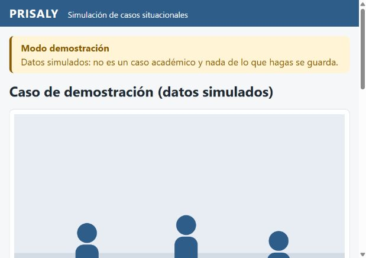

# DC-INTEGRACION-TOTAL-01 — resultado verificable

Rama backend: `integration/cierre-backend-v27`. SHA inicial: `63eceb448e6c37596ce8115080f1cdda174538a9`. Candidato productivo probado: `eb35f004b1261a57488162c631e08da1f4a744b4`. [PR #75, borrador sin fusionar](https://github.com/Cris-count/PRISALY-Backen/pull/75).

[Ejecución 42539038094](https://github.com/Cris-count/PRISALY-Backen/actions/runs/42539038094), satisfactoria. PostgreSQL 16.15 real, Java 21, APP con servidor HTTP real y entorno efímero. Los conteos siguientes pertenecen exclusivamente a ese SHA; los commits documentales posteriores no se acreditan automáticamente por esta campaña. La validación final de la cabecera se identifica en los checks del PR y su artefacto.

## Cambios implementados

| Commit | Módulo | Cambio |
|---|---|---|
| 1338dcb | M1 | Recuperación de tokens vencidos abandonados y capacidad de 10.000 sin expulsión de sesiones vigentes; saturación segura 503 |
| 2858cc4 | APP/M1 | Orden correcto de filtros, autorización estudiantil mediante StudentAccessPort sin Bearer de personal, CORS limitado y protección por Origin de operaciones inseguras |
| 5d1f8fc | M7 | Clasificación persistida de configuración SMTP, recuperación del proveedor, lease protegido y backoff saturado |
| eb35f00 | QA/documentación | Runner aislado, Postman seleccionado, matriz V27 y plan CU |

Inventario productivo: M1 modifica `ProvisionalAccessTokenStore` e `IdentityExceptionHandler`; APP modifica `HttpApiConfig`; M7 modifica `ReclamoEnvioPort`, `ReclamoEnvioJpaAdapter`, `ProcesarEnviosPendientesService` y `PoliticaReintentos`. Se amplían las pruebas correspondientes y se añaden `StudentHttpSecurityTest` y `StudentSessionControlledHttpIT`. M2, M3, M4, M5 y M6 no requieren cambios productivos independientes con los contratos disponibles; se verifica su regresión, sin reconstrucción.

## Resultados

| Módulo | Unitarias/MVC | PostgreSQL | Fallos/errores/omisiones |
|---|---:|---:|---:|
| M1 | 38 | 18 | 0 |
| M2 | 0 | 0 | Sin implementación; no aprobado como módulo funcional |
| M3 | 229 | 100 | 0 |
| M4 | 119 | 64 | 0 |
| M5 | 291 | 81 | 0 |
| M6 | 52 | 19 | 0 |
| M7 | 25 | 27 | 0 |
| APP | 47 | 97 | 0 |
| **Total Maven** | **801** | **406** | **0** |

- 1.207 pruebas Maven aprobadas, sin suites de integración seleccionadas faltantes. No se suman campañas históricas.
- 32 escenarios HTTP: 32 aprobados, cero fallidos/bloqueados. Incluyen autenticación, borradores, programación, convocatorias y denegaciones. Los casos Publicado de fixture prueban consumo del estado; no publicación académica.
- Postman/Newman: 13 peticiones reales y 48 aserciones aprobadas, cero fallos. Carpetas seleccionadas: sistema, autenticación M1 e identidad/permisos. Las otras carpetas no se declaran ejecutadas.
- Cuatro pruebas auxiliares Node aprobadas; no son respuestas HTTP.
- Excluido de forma explícita el diagnóstico archivado V010 de `Bd0052BaselineIT`; se ejecutan sus tres métodos canónicos. No es un resultado aprobado ni un `skip` de JUnit.
- APP arrancó con el esquema histórico en la campaña HTTP y con candidatas DD-02 en la suite estudiantil aislada. No se cambió el descubrimiento productivo de Flyway.
- A01: expiración, revocación, capacidad y concurrencia comprobadas. A02/A03: sesión válida por HTTP sin Bearer institucional, revocación/inactividad/expiración y orígenes negativos comprobados. A04: siete rechazos de configuración seguidos de recuperación SMTP real con GreenMail; lease abandonado y resultado obsoleto rechazados. No acredita entrega en buzón externo.
- Recursos propios de la campaña HTTP eliminados satisfactoriamente. No hubo acceso a bases compartidas.

## Arquitectura, trazabilidad y alcance

Dependencias Maven verificadas sin ciclos. Se conservan los puertos/proveedores institucionales, D-06, bloqueos, rollback, integridad y migraciones sin diferencias. El runner temporal no modifica `backend-ci.yml`. [Control de arquitectura y patrones](CONTROL-INTEGRACION.md).

[Matriz de 27 RF](V27-MATRIZ.md), [trazabilidad con clases/endpoints/suites/commits](v27-trazabilidad.json) y [plan de los 21 CU históricos](PLAN-21-CU.csv). Sus nombres y relaciones se recuperaron de fuentes locales identificadas con SHA-256. Los resultados parciales no acreditan los CU completos ni todos sus CA. La matriz histórica de gestión 43,7 % corresponde a bc8e378; no se transforma en un porcentaje actual por contar pruebas. No se declara superar el 70 % ni un nuevo RF completo.

Bloqueos vigentes: mecanismo definitivo DD-02, aprobación y conciliación compartida de V011/V012, políticas institucionales M3/publicación/archivado, completitud de rúbrica legacy/SQL, DD-03, elegibilidad/tiempo de inicio y D07, autorización de evaluación/escritura/publicación M6. DD-04 conserva último intento autorizado y evaluado. M2 sigue sin alcance funcional definido. No se habilitan endpoints ni políticas por inferencia.

## Frontend y SIM-01

Repositorio separado, rama `integration/sim01-existente`, SHA `0331392372cee28be226ffa131e66c89f8716099`, recuperada desde `origin/feature/simulador-2d`. Sin cambios productivos de frontend ni fusión. Build aprobado con Node 24.15.0, 70 pruebas ChromeHeadless aprobadas y URLs verificadas. Se comprobó escena, selección de respuesta y avance 1/3 en navegador. El modo demostración advierte que no guarda datos; no representa participación ni nota académica.

## Evidencias conservadas

- [Paquete saneado de Actions](../evidencias/DC-INTEGRACION-TOTAL-01/aceptacion-42539038094.zip): XML, casos, comandos, logs y respuestas HTTP reales.
- [Resumen Maven](../evidencias/DC-INTEGRACION-TOTAL-01/maven-summary.json), [HTTP](../evidencias/DC-INTEGRACION-TOTAL-01/http-summary.json) y [Postman](../evidencias/DC-INTEGRACION-TOTAL-01/postman-summary.json).
- [Verificación local y DAG](../evidencias/DC-INTEGRACION-TOTAL-01/local-summary.json).
- [Build SIM-01](../evidencias/DC-INTEGRACION-TOTAL-01/sim01-build.txt) y [pruebas SIM-01](../evidencias/DC-INTEGRACION-TOTAL-01/sim01-tests.txt).

La ejecución centralizada concluye los defectos técnicos A01–A04 en el alcance probado. El recorrido académico de 14 pasos no está habilitado de extremo a extremo: faltan decisiones y contratos explícitos. El PR queda disponible para revisión; esta entrega no constituye aceptación ni ratificación de Dirección Central.
