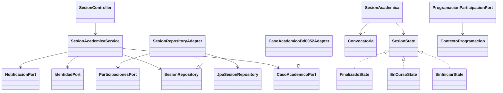
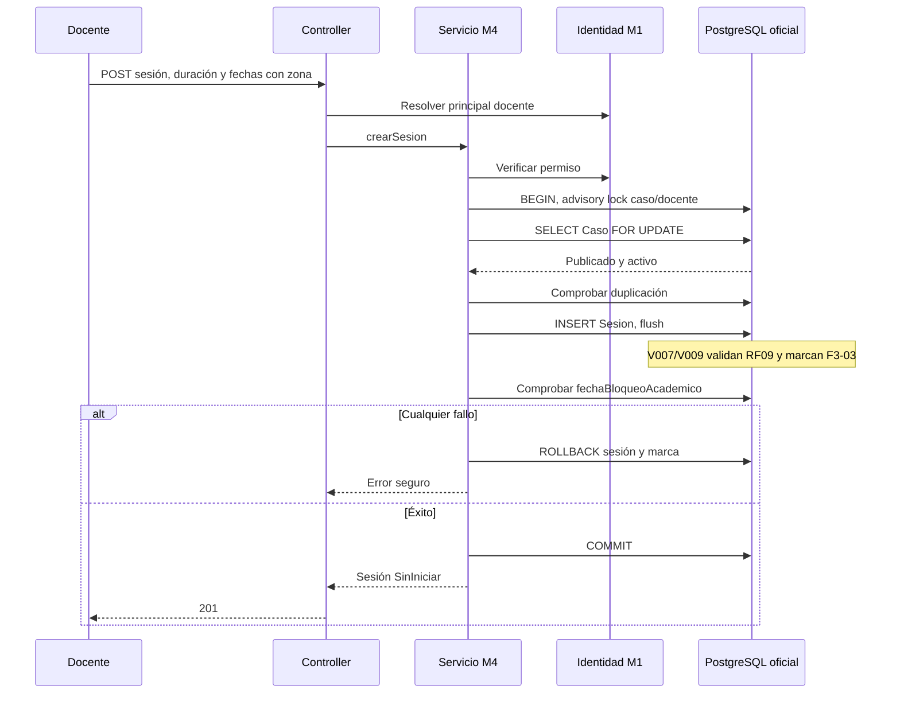

# Contratos, endpoints y diagramas M4
## Puertos internos
Se conservan sin cambio los records y firmas de com.prisaly.m4.api. ProgramacionParticipacionPort consulta contexto por convocatoria y estudiante persistidos; ProgramacionAutenticadaPort obtiene identidad mediante StudentAccessPort. ContextoProgramacion ofrece estado exacto de sesión/caso, casoActivo, ventana prevista, fechas reales opcionales, duración, autorización/retiro de convocatoria y observadoEn. No ofrece una decisión de inicio/reanudación/repetición.

M3: adaptador SQL con Caso FOR UPDATE, inserción Sesion y triggers oficiales dentro de la misma transacción. Requiere revisión del protocolo con el Integrante 2. M5: el contrato público de historial para ParticipacionesPort sigue pendiente; no se accede a repositorios internos ajenos.

## Diccionario HTTP
Prefijo de controlador /m4/sesiones; app agrega /api. Identidad del docente desde M1. X-Docente-Id es opcional, solo comprueba coincidencia con identidad autenticada.

| Método y ruta relativa | Entrada | Respuesta |
|---|---|---|
| POST / | casoId, titulo, mensajePersonalizado opcional, fechaInicio, fechaFin, tiempoMaximoParticipacionSegundos | 201 sesión |
| GET / | docenteId opcional, debe coincidir | 200 sesiones del docente |
| GET /{sesionId} | UUID | 200 sesión propia |
| PUT /{sesionId} | titulo, mensajePersonalizado, fechaInicio, fechaFin | 200; requiere historial M5 disponible y ausencia de participaciones |
| PATCH /{sesionId}/estado | nuevoEstado: EnCurso o Finalizado | 200; State valida transición |
| POST /{sesionId}/convocatorias | estudianteId | 201 convocatoria, requiere proveedor M7 |
| GET /{sesionId}/convocatorias | UUID | 200 convocatorias de sesión propia |
| GET /{sesionId}/acceso/{estudianteId} | UUID | 410; nunca autoriza |

No hay endpoint REST para cambiar caso: es operación interna de servicio. No se añaden endpoints abrir/cancelar/retiro/repetición.

Fechas ISO8601 con zona (por ejemplo 2026-11-09T13:00:00Z), convertidas a Instant. Fecha fin debe superar inicio. Duración entera positiva obligatoria al crear; no se deduce del rango. titulo máximo150. Entrada descripcion se acepta como alias de mensajePersonalizado; salida usa mensajePersonalizado. El cambio de nombres de estado y la duración obligatoria requieren adaptación del consumidor; no se aceptan silenciosamente estados anteriores.

Sesión de salida: id, casoId, docenteId, titulo, mensajePersonalizado, fechaInicio, fechaFin, estado, creadoEn, fechaInicioReal, fechaFinReal, tiempoMaximoParticipacionSegundos. Sin version, actualizadoEn ni hash de autorización.
Convocatoria de salida: id, sesionId, estudianteId, convocadoEn, estadoAutorizacion, fechaRetiro.

Errores: {"code":"M4-…","message":"…"}; 400 datos/UUID/fechas, 401 sin autenticación,403 sin permiso/ajeno,404 sesión ausente,409 conflicto académico/duplicado/bloqueo,410 acceso retirado,503 proveedor no disponible,500 inesperado. Spring conserva405/406/415 y cabeceras de protocolo. No se expone SQL en el cuerpo. El formato coincide estructuralmente con M1/M5, pendiente ratificación central.

## Clases

## Programación

