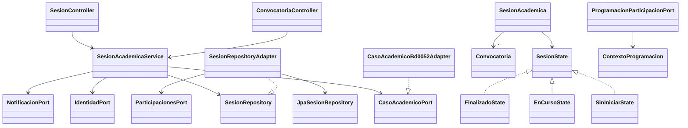
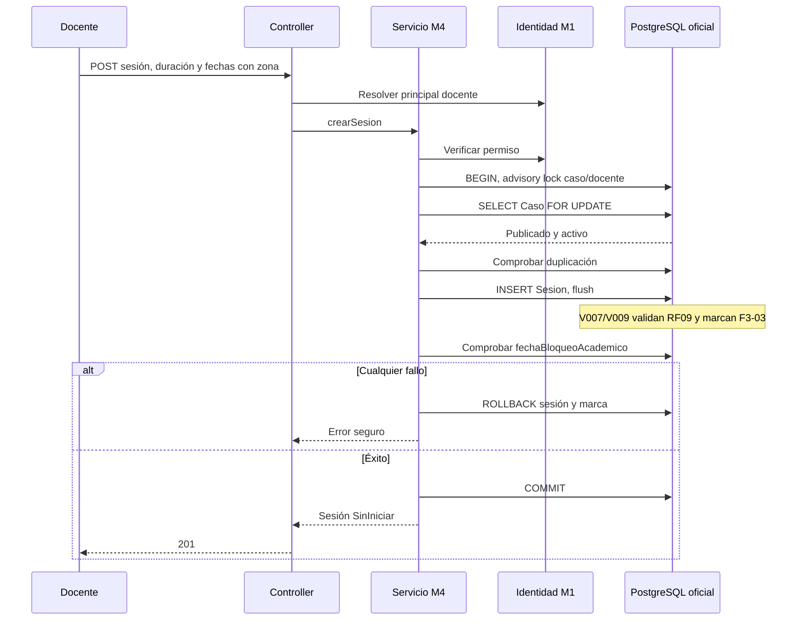

# Contratos, endpoints y diagramas M4

> Corte vigente 02/11/2026: véase «Actualización D-06» al final. Se añade ProgramacionInicioCoordinadoPort sin cambiar las firmas de consulta existentes. Las propuestas del 01/11 se conservan como antecedentes; el lector de contexto ya está habilitado en app, el primer inicio productivo continúa denegado.
## Puertos internos
Se conservan sin cambio los records y firmas de com.prisaly.m4.api. ProgramacionParticipacionPort consulta contexto por convocatoria y estudiante persistidos; ProgramacionAutenticadaPort obtiene identidad mediante StudentAccessPort. ContextoProgramacion ofrece estado exacto de sesión/caso, casoActivo, ventana prevista, fechas reales opcionales, duración, autorización/retiro de convocatoria y observadoEn. No ofrece una decisión de inicio/reanudación/repetición.

M3: adaptador SQL con Caso FOR UPDATE, inserción Sesion y triggers oficiales dentro de la misma transacción. Requiere revisión del protocolo con el Integrante 2. M5: app descubre el único proveedor ParticipacionesM4DesdeM5 (M5), que consume HistorialParticipacionPort. La configuración duplicada HistorialM4M5Configuration fue retirada en19cf52b. M4 obtiene los UUID de todas sus convocatorias con ConvocatoriaRepository; M5 consulta sus participaciones persistidas. No se accede a repositorios internos ajenos ni se crea una dependencia Maven M4→M5.

## Integración M4–M5 vigente

- M5 resuelve `Intento.idParticipacion → Participacion.idConvocatoria` desde sus datos persistidos. No autoriza usando una convocatoria enviada libremente por Angular.
- M1 debe aportar `studentId`, distinto de `userId`. `ProgramacionAutenticadaPort` no acepta un estudiante declarado por el cliente; DD-02 conserva denegación segura.
- `Optional.empty()` representa convocatoria inexistente o ajena, sin revelar titularidad. El control provisional M5 distingue inexistente (404) de ajena (403); la elección académica403/404 sigue pendiente de ratificación.
- `ConsultaProgramacionNoDisponibleException` significa indisponibilidad, nunca ausencia o permiso. M5 la traduce a503. Su control de titularidad ya está conectado a M4; las traducciones de identidad siguen pendientes de ratificación.
- El contexto no contiene hash/código de autorización, respuestas, calificaciones ni una autorización de repetición. La lectura es una instantánea SELECT; no reserva ni mantiene bloqueos después de devolver el DTO.
- `observadoEn` usa `clock_timestamp()` PostgreSQL. M5 ya persiste fin y actualización con clock_timestamp() PostgreSQL; falta ratificar una autoridad temporal común, bordes y tolerancia. El reloj del navegador no decide vigencia.
- Para reanudar, M5 necesita el mismo intento persistido, su inicio, límite temporal, estado y respuestas confirmadas, además de consultar nuevamente el contexto M4. No debe crear otro intento ni reiniciar el reloj por una reanudación.
- M5 dispone del motivo `TIEMPO_VENCIDO`, pero faltan la regla efectiva de vencimiento y su mecanismo de detección. Guardar una finalización y luego lanzar una excepción en la misma transacción puede revertirla: el caso de uso debe resolver esa frontera antes de habilitarse.
- Repetición y número de intento corresponden a M5/DD-14. Las reglas oficiales V005/V007 de historial y consumo atómico de autorización no se sustituyen por un booleano M4. M4 no ofrece `puedeRepetir`.

La resolución persistida, el retiro y el fallo real de consulta se verifican en las pruebas PostgreSQL M5; consultar [resultados actuales](../revision-m4-m5/evidence/RESULTADO.md). No demuestran inicio/reanudación productivos ni el control de acceso conectado a un endpoint.

### Protección de historial desde M4

SesionRepositoryAdapter de M4 exige la transacción de escritura del llamador antes de delegar al proveedor único M5. SesionAcademicaService bloquea primero la fila de sesión y luego consulta el historial. Una participación basta para impedir edición o reasignación (409 M4-SESION-CON-PARTICIPACIONES); los intentos quedan cubiertos por su FK obligatoria a Participacion. Se incluyen convocatorias retiradas. Sin participaciones se conserva la validación normal de M4.

La ausencia del proveedor o el fallo de consulta provoca 503 M4-PROVEEDOR-NO-DISPONIBLE, mensaje público genérico y rollback. La consulta sin transacción de escritura se rechaza. M4 conserva su respaldo seguro para ensamblados sin app/M5.

El futuro inicio de participaciones debe adquirir el mismo bloqueo de sesión antes de insertar. Esta integración no implementa inicio/reanudación ni permite afirmar que esa carrera futura esté resuelta. No hay cambios de esquema ni de identidad estudiantil.

## Diccionario HTTP
SesionController atiende /m4/sesiones; ConvocatoriaController atiende /m4/sesiones/{sesionId}/convocatorias. app agrega /api. La separación conserva las rutas existentes. Identidad del docente desde M1. X-Docente-Id es opcional, solo comprueba coincidencia con identidad autenticada.

| Método y ruta relativa | Entrada | Respuesta |
|---|---|---|
| POST / | casoId, titulo, mensajePersonalizado opcional, fechaInicio, fechaFin, tiempoMaximoParticipacionSegundos | 201 sesión |
| GET / | docenteId opcional, debe coincidir | 200 sesiones del docente |
| GET /{sesionId} | UUID | 200 sesión propia |
| PUT /{sesionId} | titulo, mensajePersonalizado, fechaInicio, fechaFin | 200; requiere historial M5 disponible y ausencia de participaciones |
| PATCH /{sesionId}/estado | nuevoEstado: EnCurso o Finalizado | 200; State valida transición |
| POST /{sesionId}/convocatorias | estudianteId | 201 convocatoria, requiere proveedor M7 |
| GET /{sesionId}/convocatorias | UUID | 200 convocatorias de sesión propia |
| GET /{sesionId}/acceso/{estudianteId} | UUID | 410; nunca autoriza |

No hay endpoint REST para cambiar caso: es operación interna de servicio. No se añaden endpoints abrir/cancelar/retiro/repetición.

Fechas ISO8601 con zona (por ejemplo 2026-11-09T13:00:00Z), convertidas a Instant. Fecha fin debe superar inicio. Duración entera positiva obligatoria al crear; no se deduce del rango. titulo máximo150. Entrada descripcion se acepta como alias de mensajePersonalizado; salida usa mensajePersonalizado. El cambio de nombres de estado y la duración obligatoria requieren adaptación del consumidor; no se aceptan silenciosamente estados anteriores.

Sesión de salida: id, casoId, docenteId, titulo, mensajePersonalizado, fechaInicio, fechaFin, estado, creadoEn, fechaInicioReal, fechaFinReal, tiempoMaximoParticipacionSegundos. Sin version, actualizadoEn ni hash de autorización.
Convocatoria de salida: id, sesionId, estudianteId, convocadoEn, estadoAutorizacion, fechaRetiro.

Errores: {"code":"M4-…","message":"…"}; 400 datos/UUID/fechas, 401 sin autenticación,403 sin permiso/ajeno,404 sesión ausente,409 conflicto académico/duplicado/bloqueo,410 acceso retirado,503 proveedor no disponible,500 inesperado. Spring conserva405/406/415 y cabeceras de protocolo. No se expone SQL en el cuerpo. El formato coincide estructuralmente con M1/M5, pendiente ratificación central.

## Clases


## Programación


## Propuesta de conciliación de estabilización — pendiente de ratificación

M4 no inserta Participacion. La propuesta recibida asigna a M5 su creación durante el primer inicio autorizado, junto con Intento en una misma transacción; sigue pendiente confirmación formal de Dirección/M5. Se mantienen las propiedades: M4=Sesion/Convocatoria; M5=Intento/Respuesta. No se incorpora código de creación ni elegibilidad por esta propuesta.

| Decisión | Propuesta para revisión | Implementado en este incremento |
|---|---|---|
| Escritor de Participacion | M5, únicamente primer inicio autorizado | No; requiere ratificación |
| Datos del inicio | Convocatoria persistida, estudiante de M1, contexto M4 y política académica aprobada; no identidad declarada por Angular | Solo contratos informativos existentes |
| Duplicados | Reutilizar Participacion por idConvocatoria y restricción uq_participacion_idconvocatoria; acordar respuesta idempotente o conflicto | Restricción oficial verificada, no nuevo escritor |
| Rollback | Participacion e Intento nuevos deben confirmarse juntos; error revierte ambos | Probados rollback M4 y FK/UNIQUE con fixtures, no inicio productivo |
| Convocatoria | M5 resuelve la existente desde sus datos; M4 filtra titularidad | Sí, consultarConvocatoria existente |
| Listado propio | Proponer List<ContextoProgramacion> listarConvocatoriasEstudianteActual() en ProgramacionAutenticadaPort, obteniendo studentId de M1; paginación y contrato final por ratificar | No; no nueva ruta ni interfaz implementada |
| Elegibilidad | M5 orquesta la política ratificada usando hechos M4; M4 conserva State e invariantes propias | Pendiente DD-01/DD-02/DD-05/DD-14; no booleano permisivo |
| Activación lectora | Integración debe iniciar app con --prisaly.m4.consulta-bd0052.enabled=true, de forma controlada | Configuración probada en M4, no se altera app productiva por una solicitud pendiente |

Firmas existentes conservadas: ProgramacionParticipacionPort.consultarSesion(UUID sesionId, UUID estudianteAutenticadoId) y consultarConvocatoria(UUID convocatoriaId, UUID estudianteAutenticadoId), ambas Optional<ContextoProgramacion>. ProgramacionAutenticadaPort ofrece consultarSesion(UUID) y consultarConvocatoria(UUID), usando StudentAccessPort. Optional.empty significa ausencia/titularidad no coincidente; indisponibilidad es excepción503, no false.

### Protocolo transaccional propuesto el 01/11 (antecedente; sustituido por D-06 abajo)

1. M5 obtiene identidad estudiantil confiable de M1; no usa un studentId libre del frontend.
2. En la transacción de inicio, solicitar a M4 el bloqueo de Sesion y después de Convocatoria, volver a leer titularidad/estado/retiro y evaluar la política ratificada.
3. Solo después obtener/crear Participacion y bloquear/crear Intento según política de primer inicio o repetición. Mantener bloqueos hasta commit.
4. Edición, convocatoria y cambios de estado M4 ya toman Sesion FOR UPDATE. El futuro inicio debe compartir ese punto de serialización; no leer primero sin bloqueo y asumir que el contexto permanece vigente.
5. Evitar un camino inverso Intento→Sesion mientras exista otro Sesion→Intento. Acordar orden con M3, retirada y cierre; no declarar resueltas todas las carreras.

Firma orientativa para revisión: Optional<ContextoProgramacion> bloquearConvocatoriaDelEstudianteActual(UUID convocatoriaId), con transacción de escritura MANDATORY, identidad de M1 y devolución de hechos, sin conceder por sí sola elegibilidad. No se publica ni implementa mientras no esté ratificada.

### H06/H16 y F3-04

Las pruebas usan un reloj fijo para las fronteras de las fixtures y comprueban la lectura inmutable de SinIniciar/EnCurso/Finalizado antes, en y después de inicio/fin. No sustituyen clock_timestamp() PostgreSQL ni prueban un scheduler de vencimiento. DD-01/DD-05 y las reglas de cierre/reanudación/repetición permanecen pendientes.

F3-04 permite máximo positivo inferior, igual o superior al estimado. Se prueban30/60/120 segundos frente a un caso estimado en60, sin agregar una relación máximo≤estimado. V007 documenta que no requiere migración. El texto original RF-18/H16 debe conciliarse antes de modificar esta decisión.

## Actualización D-06 — 02/11/2026

La Dirección Técnica autorizó implementar la reserva con orden Sesion → Convocatoria → Participacion → Intento. El candidato feature/m4-cierre-d06, basado en develop b3d77d8, ofrece el siguiente puerto público interno de M4:

```java
public interface ProgramacionInicioCoordinadoPort {
    Optional<ContextoProgramacion> bloquearYConsultarConvocatoria(
        UUID convocatoriaId, UUID estudianteAutenticadoId);
}
```

Requiere la transacción de escritura del consumidor (MANDATORY, READ COMMITTED). M4 localiza la sesión, bloquea primero Sesion y después Convocatoria mediante FOR UPDATE, revalida la asociación y devuelve contexto fresco. Retiene los bloqueos hasta commit/rollback de M5. Vacío para convocatoria inexistente/ajena; fallo técnico, solo lectura, aislamiento incompatible o incoherencia producen ConsultaProgramacionNoDisponibleException (503). Sin transacción se rechaza por la guardia transaccional. El puerto no calcula elegibilidad ni crea participación.

M5 lo consume mediante CoordinacionInicioDesdeM4 dentro de FachadaParticipacionTransaccional, antes de acceder a Participacion/Intento, obteniendo identidad del servidor. El constructor sin coordinador deniega el inicio; dobles permisivos solo en src/test. Se mantienen los bloqueos de Estudiante de los triggers históricos, sin modificar migraciones.

La consulta informativa ProgramacionParticipacionPort se conserva; no sustituye la reserva D-06. El lector está habilitado en app, pero el acceso estudiantil productivo sigue desactivado y las políticas no ratificadas continúan impidiendo el primer inicio. La propuesta anterior de listado estudiantil no se implementa en este incremento.

Si M5 confirma primero, la edición M4 espera y rechaza por historial. Si M4 confirma primero, M5 observa el contexto modificado y aplica las políticas vigentes; no se autoriza por ganar la carrera. Un rollback libera la reserva sin dejar datos parciales. Reasignar caso con convocatorias continúa prohibido.

Regresión: 839 pruebas aprobadas (M4 182, M5 283, app 40), incluidos 13 casos conjuntos D-06; cero fallos/errores/omitidas. Ver sección 10 de ../revision-m4-m5/INFORME.md para evidencia, límites y versión del candidato. Pendiente revisión del PR; sin merge unilateral ni activación académica nueva.
