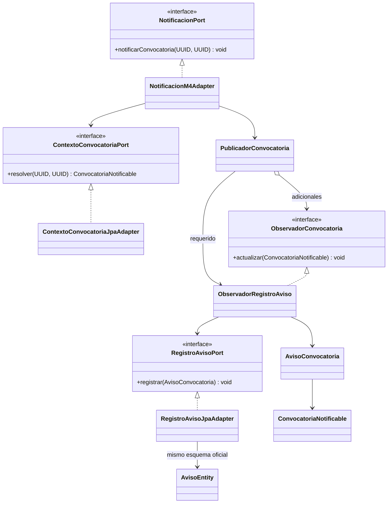
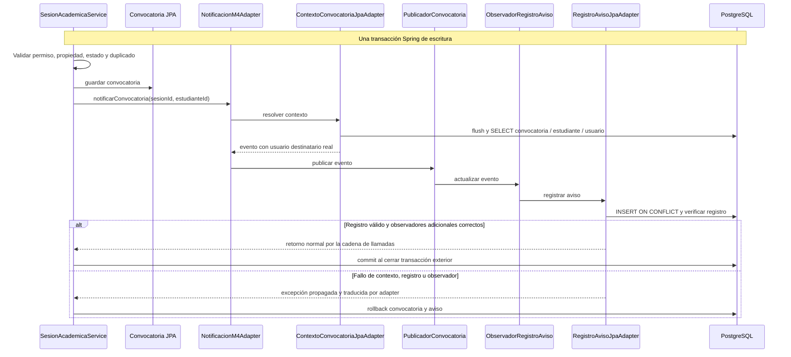

# M7-INC-01 — avisos internos de convocatoria

Fecha: 2026-11-01 (America/Bogota). Rama: `feature/m7-comunicaciones`. Base verificada: `2c96c912923c8e90ab1c74e3fcfd8aeb29265249`, coincidente con origin/develop al iniciar.

## Decisión funcional y alcance

La orden de Dirección Técnica condicionó el registro interno a ratificación. El responsable confirmó «confirmada» en este chat al preguntarle expresamente por la ratificación de Dirección Central y Arquitectura. Esa confirmación autoriza este incremento; no se inventa un identificador de decisión institucional. Se recomienda incorporar la referencia al registro DD oficial del equipo.

Retorno normal de `NotificacionPort.notificarConvocatoria(sesionId, estudianteId)` significa que existe un aviso interno válido en la misma transacción de escritura de M4. No implica commit de una transacción exterior aún abierta, envío de correo, entrega ni lectura. Un error impide el éxito de la convocatoria y revierte la transacción. La firma y el Javadoc histórico de M4 permanecen intactos por restricción de alcance; esta decisión documenta la semántica ratificada para M7-INC-01.

No se encontraron V27, catálogo CU ni ARQ-008.2/008.3 completos. No se atribuyen códigos RF/CU a M7. RF09 y F3-03 se mencionan exclusivamente como reglas existentes de M4/base que deben preservarse, no como nuevos requisitos M7. No hay correo, uso de EnvioCorreo, resultados, reportes, autenticación estudiantil ni REST nuevo. DD-02 y DD-12 continúan pendientes.

## Inventario previo y archivos

Antes de editar: rama correcta y base esperada; único cambio local, el diagnóstico de esta misma tarea, sin cambios ajenos. M7 contenía solo POM y package-info. App ya dependía de M7 y su `@SpringBootApplication` escanea `com.prisaly`. M4 guardaba Convocatoria y llamaba al puerto dentro de `@Transactional`. Su fallback seguro era una excepción 503.

Cambios confinados a `m7/`: dominio, aplicación, infraestructura, pruebas, POM y documentación. No se editan M1/M3/M4/M5/M6, App, configuración raíz ni migraciones V001–V009. M7 depende del artefacto M4 para su interfaz pública; M4 no depende de M7, por lo que no se crea un ciclo. El artefacto M4 trae sus dependencias transitivas habituales, pero el código M7 no importa implementaciones internas de otros módulos.

## Capas, contratos y patrones

| Capa | Implementación | Responsabilidad |
| --- | --- | --- |
| Dominio | ConvocatoriaNotificable, AvisoConvocatoria | Identidad mínima, clave determinista, contenido no vacío |
| Aplicación | ContextoConvocatoriaPort, RegistroAvisoPort | Contexto y registro independientes de JPA |
| Aplicación | PublicadorConvocatoria, ObservadorConvocatoria, ObservadorRegistroAviso | Observer síncrono con observador de registro obligatorio |
| Infraestructura | NotificacionM4Adapter | Adapter de entrada compatible con NotificacionPort |
| Infraestructura | ContextoConvocatoriaJpaAdapter | Resolución SQL de convocatoria y Estudiante.idUsuario |
| Infraestructura | RegistroAvisoJpaAdapter, AvisoEntity | Adapter de salida PostgreSQL y mapeo validable |
| Infraestructura | M7Configuration | Inyección Spring del proveedor real y observadores |
| Presentación | Sin componentes HTTP | No existe contrato REST aprobado |

El publicador exige un ObservadorRegistroAviso al construirse. Primero lo ejecuta y luego notifica los observadores adicionales registrados como beans, sobre una lista inmutable. Se pueden incorporar observadores sin cambiar M4. Todos deben operar síncronamente y con efectos transaccionales locales; correo o servicios externos no pueden agregarse como observadores sin revisar esta garantía.

No se usan Spring Application Events ni ejecutores asíncronos: publicar llama directamente al observador requerido y propaga el error. El observador solicita la escritura por RegistroAvisoPort. La publicación por sí sola no completa el contrato.

El adapter de entrada conserva la firma UUID/UUID de M4; exige transacción de escritura mediante `Propagation.MANDATORY` y comprobación adicional. Resuelve contexto mediante un puerto M7, valida que sesión/estudiante coincidan y publica. Los fallos dentro del flujo se traducen al código existente `M4-PROVEEDOR-NO-DISPONIBLE`, con mensaje seguro; M4 ya lo traduce a HTTP 503. Una llamada al proxy sin transacción se rechaza antes de iniciar el método: no es una nueva API pública.

## Persistencia, identidad e idempotencia

Antes de consultar, el adapter de contexto hace `EntityManager.flush()`: M4 utiliza JPA save y la convocatoria podría no haberse insertado aún. Flush no realiza commit. Consulta Convocatoria por (idSesion, idEstudiante), exige fechaRetiro nula y resuelve Estudiante.idUsuario con Usuario existente. No consulta repositorios internos de M4 ni de M1. Los UUID identifican contexto; no autentican. La autorización de la operación sigue siendo responsabilidad del servicio M4/M1.

La unicidad oficial de (idSesion, idEstudiante) identifica una sola convocatoria. `claveEvento = convocatoria:<idConvocatoria>` es estable, cabe en varchar(150) y queda aislada por el destinatario según la unicidad oficial de Aviso. Dos estudiantes de una misma sesión tienen convocatorias y claves distintas. No se crean identidades nuevas para reintentos ni se decide una política de reconvocatoria.

RegistroAvisoJpaAdapter utiliza SQL parametrizado `INSERT ... ON CONFLICT (idUsuarioDestino, claveEvento) DO NOTHING`. PostgreSQL arbitra las carreras sin capturar violaciones de unicidad dentro de una transacción ya abortada. Se verifica que el registro resultante sea de tipo Convocatoria, sin idParticipacion y con contenido no vacío. Una colisión incompatible es error. El reintento conserva idAviso, contenido, fechaCreacion y fechaLectura previos; un cambio posterior del texto configurado no reescribe avisos históricos.

Se escribe únicamente Aviso: UUID de aviso, usuario destino, tipo `Convocatoria`, contenido mínimo y claveEvento. FechaCreacion usa el default oficial; idParticipacion y fechaLectura permanecen nulos. No se crean estados de enviado/entregado. AvisoEntity mapea las ocho columnas oficiales, separado del dominio. App ya tiene ddl-auto=validate, y las pruebas usan validate con V001–V009 reales. No se agregan tablas, columnas ni migraciones.

Texto por defecto: `Se ha registrado tu convocatoria a la sesión {sesionId}.`. Configurable mediante `prisaly.m7.texto-convocatoria`; el único reemplazo implementado es `{sesionId}`. Configurar contenido institucional no sensible. El evento no tiene campos de correo, contraseña, respuestas ni calificaciones.

## UML de clases



AvisoEntity valida el esquema; las escrituras usan SQL nativo, no una asociación ORM con las entidades de otros módulos.

## Secuencia transaccional



## Matriz de integración M4–M7

| Condición | Efecto |
| --- | --- |
| M7 disponible y convocatoria válida | Convocatoria y aviso en la misma transacción |
| Rechazo M4 previo al puerto | Sin efecto M7 |
| Contexto ausente, destinatario inexistente o fallo SQL | Error y rollback |
| Fallo de observador posterior al registro | Error y rollback de ambas escrituras |
| Fallo exterior antes de commit | Rollback de ambas escrituras |
| Repetición de notificación de misma convocatoria | Mismo aviso, sin reescribir lectura |
| Doble convocatoria concurrente | Una válida; otra rechazada por M4 |
| M7 no incluido en aplicación | Fallback seguro M4 conservado |

## Contrato REST preliminar, no publicado

No se definen rutas, verbos ni DTO definitivos sin ARQ-008.3. Para futura consulta propia: identidad del usuario obtenida del contrato M1 aprobado, filtro obligatorio por usuario destino, respuesta limitada a identificador de aviso, tipo, contenido y fechas. Para futura lectura: verificar titularidad antes de escribir fechaLectura y acordar idempotencia. No aceptar usuarioDestino del frontend como prueba de titularidad. Hasta resolver DD-02 y el contrato, no hay controlador ni consulta habilitada.

## PT-DCP-01 — matriz ejecutable M7

| Ficha local propuesta | Prueba automatizada | Cobertura |
| --- | --- | --- |
| M7-U01 | identidadEstableYDestinatarioDistinto | Identidad determinista, diferencia estudiante/usuario |
| M7-U02 | camposObligatorios | Campos nulos y texto vacío |
| M7-U03 | registroEsSincronoYPrevioAExtensiones | Orden, contenido y lista inmutable |
| M7-U04 | faltaDeObservadorNoEsExito | Observador requerido |
| M7-U05 | falloDeRegistroSePropagaSinEjecutarExtensiones | Error temprano |
| M7-U06 | falloPosteriorNoSeOculta | Error posterior |
| M7-U07 | adapterResuelveContextoYRegistraSinAutenticarPorUuid | Adaptación y destinatario |
| M7-U08 | adapterDeniegaSinTransaccionYNoConsulta | Rechazo seguro |
| M7-U09 | adapterNoFiltraErroresDelProveedor | Mensaje seguro |
| M7-U10 | contextoAjenoNoProduceAviso | Consistencia de contexto |
| M4-M7-I01 | convocatoriaYAvisoAtomicosConDestinatarioCorrecto | M4/JPA, Aviso, migraciones, F3-03, sin correo |
| M4-M7-I02 | rechazoDeM4NoGeneraAviso | No autenticado / sin escrituras |
| M4-M7-I03 | destinatarioInexistenteRevierteConvocatoria | FK y rollback |
| M4-M7-I04 | observadorPosteriorFallaYRevierteAmbasEscrituras | Rollback tras observador |
| M4-M7-I05 | falloDespuesDelServicioAntesDeCommitRevierteAmbos | Fallo exterior |
| M4-M7-I06 | repeticionNoDuplicaNiReescribeLectura | Idempotencia e historial |
| M4-M7-I07 | sinConvocatoriaNoSeRegistra | Contexto ausente |
| M4-M7-I08 | falloSqlDeAvisoRevierteConvocatoria | Error SQL real |
| M4-M7-I09 | integridadReferencialDeAviso | FK Usuario |
| M4-M7-I10 | dosDestinatariosMismaSesionSonEventosDistintos | Aislamiento de destinatarios |
| M4-M7-I11 | dosRegistrosConcurrentesDelMismoEventoNoDuplican | Conflicto único real |
| M4-M7-I12 | dosConvocatoriasConcurrentesSoloUnaEsExitosa | Locks M4 y resultado consistente |

Las fichas son propuestas locales, sin asignación inventada de RF/CU. La identidad docente permisiva se limita al TestApplication anidado en src/test. La integración usa servicios/repositorios reales de M4, configuración productiva M7, Hibernate validate y PostgreSQL 16.15 con migraciones oficiales. No certifica autenticación M1 estudiantil. Las pruebas HTTP M7 de consulta ajena/lectura siguen sin aplicar porque no existe API publicada.

## Defectos encontrados y corregidos

1. La primera ejecución de IT no tenía autoconfiguración Flyway en el classpath de prueba; Hibernate validate rechazó la ausencia de Aviso. Se añadió spring-boot-starter-flyway exclusivamente para pruebas. La segunda ejecución aplicó las nueve migraciones y pasó.
2. En revisión se detectó ambigüedad entre el placeholder `{sesionId}` y una expresión `@Value` con valor por defecto. Se usa Environment.getProperty con texto literal. No se alteró configuración compartida.
3. El primer comando Maven focalizado fue rechazado por segmentación PowerShell de una propiedad `-D`; se corrigió pasando cada propiedad completa entre comillas. No fue un fallo del código.

## Evidencia de ejecución

Prueba focalizada: **10 unitarias y 12 PostgreSQL aprobadas, cero fallos/errores/omitidas**, BUILD SUCCESS. Comando PowerShell:

```powershell
.\mvnw.cmd -B -pl m7 -am verify -Pdocker-it '-Dtest=M7*Test' '-Dsurefire.failIfNoSpecifiedTests=false' '-Dit.test=M7*IT' '-Dfailsafe.failIfNoSpecifiedTests=false'
```

Salida: `m7-postgres.log` en raíz (ignorada por Git); informes XML en m7/target/surefire-reports y m7/target/failsafe-reports. No se suman pruebas de dependencias excluidas por los filtros.

Regresión completa: **BUILD SUCCESS, 467 pruebas aprobadas, cero fallos/errores/omitidas**, finalizada el 2026-11-01 a las 16:28:41 America/Bogota, duración 3:35. M4 conserva 149 pruebas, M5 145 y App 10. M7 incorpora 22. Se verificó también M1 (14) y M3 (127). M2/M6 no aportan pruebas a este corte.

```powershell
.\mvnw.cmd -B verify -Pdocker-it '-Dm4.baseline.migrations=C:/Users/NICOLAS/OneDrive/Desktop/Prisaly/PRISALY-Backen/app/src/main/resources/db/migration'
```

Salida completa: `m7-regression.log` en raíz (ignorada por Git). [Resumen verificable](evidence/RESULTADO.md) y [conteo por suite](evidence/suites.json). El colector incluyó solamente XML modificados desde el inicio de esta ejecución; no sumó informes obsoletos. Totales: 341 Surefire + 126 Failsafe = 467, coincidentes con los resúmenes Maven. Las 22 fichas M7 de la matriz anterior están aprobadas en esta ejecución. El fallback ausente de M4 está cubierto por su M4ProviderSecurityTest, también aprobado.

El intento inicial de Docker sin elevación falló; pudo iniciarse con el acceso autorizado al motor. Los contenedores de prueba son desechables y no utilizan la base compartida. Las restricciones negativas adicionales de un caso de prueba se crean y retiran solamente en ese contenedor; no alteran los archivos oficiales.

## Revisión y publicación

Sin commits, push ni merges. No se crea PR remoto sin autorización. Propuesta de commits revisables, separando según dependencias reales y sin dejar cortes que no compilen: dominio/Observer, adaptadores/configuración, pruebas y documentación. El borrador de PR se mantiene en PR-M7-INC-01.md. V27/CU y contrato REST permanecen pendientes documentales aunque la semántica de este incremento fue ratificada.
